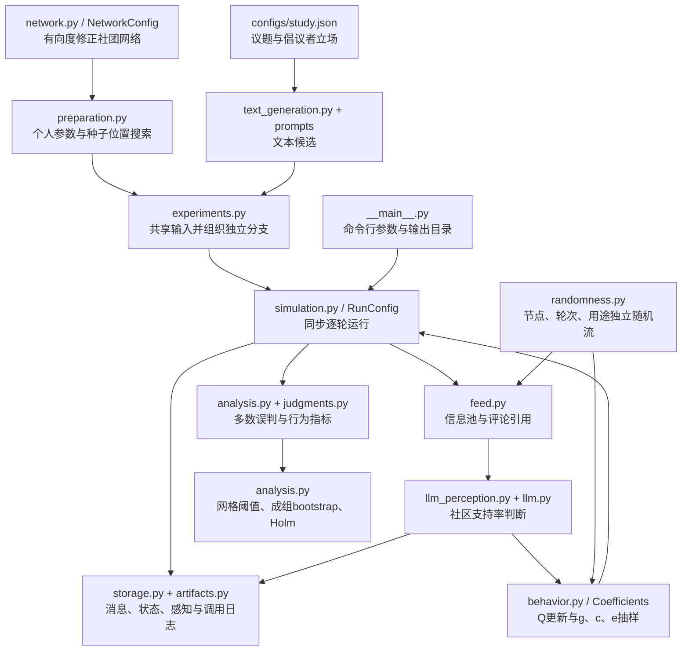

# 模型、运行与参数导航

项目目录：`D:\study\projects\complex\who_is_in_the_majority`。

本次按 PDF 前五页组织模型。实验时间固定为 2024 年美国总统大选投票前。少数倡议者固定反对特朗普当选，其余节点私人支持。感知输出 support 表示支持特朗普的比例，因此反对派多数误判对应 support < 0.5。

## 模块关系



单轮先统一发布已决定的消息，然后送达回复通知并抽取阅读内容。各节点更新感知后计算反馈 Q，再产生下一轮决策。所有节点共享同一个轮内消息快照，并发只用于缩短感知请求等待时间。

## 超参数在哪里调整

| 参数 | 调整位置 | 当前默认及作用 |
| --- | --- | --- |
| 议题、时间背景、倡议立场 | `configs/study.json` | 2024 年投票前，倡议立场 −1 |
| 节点数与社团规模 | `network.py` 的 `NetworkConfig.community_sizes` | 15、20、25、40，总数为100 |
| 关注与粉丝异质性 | `NetworkConfig.s_out`、`s_in` | 0.35、1.0 |
| 社团间权重 | `NetworkConfig.between_weight` | 0.2 |
| 期望边数、实际边数范围 | `expected_edges`、`edge_range` | 800、760至840 |
| 观测人数、图重抽次数 | `observer_count`、`max_attempts` | 30、10000 |
| 基准发言分布、强度 | `preparation.py` 的 `draw_profiles` | Beta(0.24,0.85)，强度0.4与0.8各半 |
| 倡议者人数及名单 | 命令行 `--advocates` 或 `search_seeds` 的 k | 本次8人，排除观测者 |
| 匹配容差与搜索量 | `preparation.py` 的 `SearchConfig` | 容差0.05，可设置起点数和每起点交换次数 |
| 运行轮数 | `--rounds`，对应 `models.py` 的 `RunConfig.rounds` | 程序默认20，本次验证5 |
| 阅读窗口与条数 | `RunConfig.window`、`read_limit` | 最近2轮，最多5条 |
| 学习率 α | `--alpha` 或 `RunConfig.alpha` | 0.05，采用第3页设定 |
| 倡议者发言优势 ρ | `--rho` 或 `RunConfig.rho` | 配置默认1，命令行默认3 |
| 反馈敏感度 β | `--coefficients` 指定的JSON中的 beta | 本次10 |
| 评论概率 θ | 系数JSON中的 theta | 顺序为截距、强度、逆风、强度×逆风 |
| 私人倾向 κ 与多数影响 γ | 系数JSON中的 kappa、gamma | 本次各1，gamma=0用于机制对照 |
| 评论跨粉丝传播 | `RunConfig.cross_fan_comments` | true，可设false只传播给评论者粉丝 |
| 候选数量 | `texts --per-side`、`--comments` | 每方5原创，每帖每方2评论 |
| 文本长度 | `text_generation.generate_text_bank` 的 min_chars/max_chars | 40至80字 |
| 模型、URL、超时、输出长度 | 本地 `.env` 的 DEEPSEEK_* | deepseek-v4-flash、60秒、4096输出token |
| 感知提示、生成提示 | `majority/prompts/` | 独立Markdown文件，运行保存哈希与正文 |
| 温度 | `llm_perception.py` 与 `text_generation.py` 的 request 调用 | 感知0，生成0.7 |
| 感知并发数 | `run --workers` | 默认8，改为1即串行 |
| 随机数种子 | `--seed` | 写入运行清单 |
| 尾部汇总轮数 | `analysis.tail_illusion(last=...)` | 默认5 |
| 覆盖目标与人数网格 | `analysis.grid_threshold` 的 coverage、k_grid | coverage默认0.8，网格由调用者传入 |
| 重采样次数与种子 | `analysis.paired_inference` 的 repeats、seed | 10000、42，按网络分层并整组抽取 |

调整参数后使用新输出目录运行，从而保留各次配置与结果。网络参数通过 `NetworkConfig` 构造传入生成函数，命令行 `network` 使用其默认值。阅读参数与传播开关通过 `RunConfig` 构造传入 `Simulation`。

## 本次验证口径

本次使用已经保存的100节点网络和50条候选文本，运行8名反对派倡议者的5轮真实API轨迹。系数来自 `configs/coefficients.demo.json`，用于检查状态、传播、感知和指标之间的衔接。正式行为标定使用预试选择记录确定系数，再把结果写入相同JSON结构。

前五页还描述了推荐池和私人态度变化。它们作为扩展路径，接入位置分别是 `feed.py` 的阅读池构造与 `simulation.py` 的轮末状态提交。当前验证采用关系信息池与固定私人立场。

`preparation.search_seeds` 按相同社团名额交换种子，并记录匹配窗口内的结构幻觉差值。若搜索结果为配对缺失，随机配置仍保留。`analysis.paired_inference` 以完整运行组成的配对组为样本，并在图内同步抽样各分支。`grid_threshold` 按网络等权汇总各k条件后返回达到覆盖目标的最小网格比例。

## 重运行命令

在项目目录执行，使用新的输出目录名称：

```powershell
python -m majority run --network runs/networks/network-0.json --bank runs/candidate_pool_final/bank.json --coefficients configs/coefficients.demo.json --advocates "0,2,3,4,6,7,9,10" --rounds 5 --workers 8 --alpha 0.05 --rho 3 --output runs/front5_new
```

同配置继续运行时，可在 `run` 前传入 `--reuse-calls runs/front5_trial/calls.jsonl`。复用要求任务、输入、分支和节点上下文、提示词哈希、模型名、温度与输出上限全部相同。日志以 `reused` 标记复用项，调用统计将它们单独计数。

感知输出经过字段、数值范围和证据编号校验。校验失败时追加一次纠正请求，并提供该节点实际见过的证据编号列表。日志保存两次回答。API 连接错误直接抛出并保留已完成的轮次记录。


## 实跑结果

已完成100节点、8名倡议者、5轮真实API轨迹，18项测试通过。固定私人支持率为92%，以下比例以30名观测者为分母。

| 轮次 | 反对信息流多数 J | 反对者多数误判 Qill | 公开支持特朗普 | 公开反对特朗普 | 私人支持者沉默 |
| --- | --- | --- | --- | --- | --- |
| 1 | 0.067 | 0.067 | 0.233 | 0.000 | 0.767 |
| 2 | 0.033 | 0.033 | 0.267 | 0.033 | 0.700 |
| 3 | 0.033 | 0.033 | 0.233 | 0.033 | 0.733 |
| 4 | 0.033 | 0.033 | 0.200 | 0.000 | 0.800 |
| 5 | 0.000 | 0.033 | 0.300 | 0.000 | 0.700 |

本次采用固定倡议者名单检验单分支时序，并用演示系数生成行为。种子位置搜索另在同一张图上完成1000次候选检查，获得高低结构幻觉差约0.01087，匹配诊断保存在 `runs/seed_search_check.json`。
