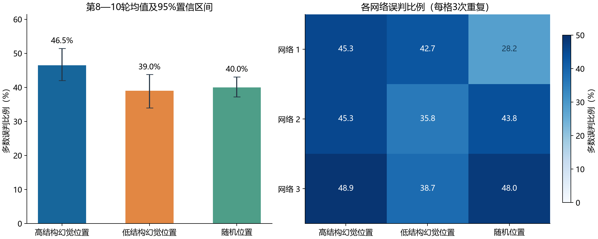
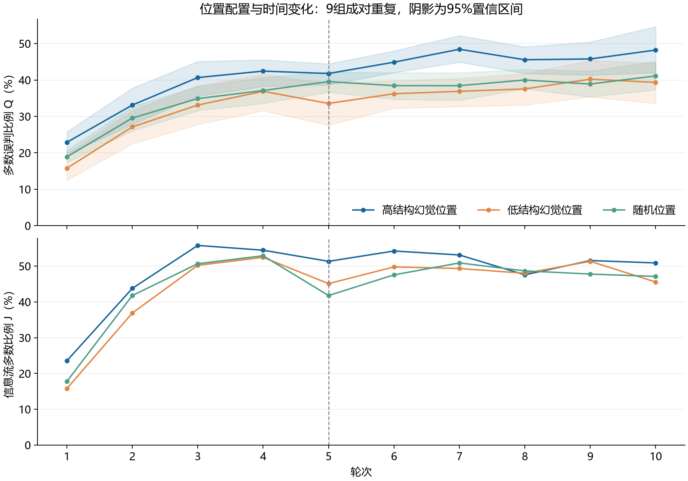

# 多数幻觉：三步实验结果与结论

2026-11-16

研究按PDF的模型与实验思路开展，第六章实验步骤仅作参考。本轮完成文本扩充、超参数初始化、连接位置主实验三步。

**指标Q**：固定50名观察者中，误认为反对者占多数的人数比例。主实验私人反对者占比固定为20%，主要结果取第8—10轮Q的平均值。

后续位置初始化采用 **高结构幻觉位置（TH）**。其末3轮平均误判比例为 **46.5%**。
高、低位置的配对差为 **+7.5 个百分点**，95% CI [+2.4, +13.2]，Holm校正 p=0.1172。

单项检验 p=0.0391；三项比较校正后未达到0.05显著性标准。TH按最高误判均值选作后续工作点。

三张网络的高低位置差分别为+2.7、+9.6、+10.2个百分点，位置效果的网络差异见热图。

## 第一步：扩充帖子与评论候选库

双方各25条原创，每条2条赞同、2条反对评论，共50条原创、200条评论；由已配置DeepSeek生成，250条文本均通过数量、长度、重复与立场关系检查。

**第一步结论**：已得到双方数量平衡、每帖评论结构一致的冻结候选库；后续各组使用同一文本库。

## 第二步：通过文献与小规模搜索初始化参数

N=100，50名观察者。先对96组参数做6轮随机搜索，再将8组候选延长并换3组网络/随机数复测；随后以真实DeepSeek验证基准、候选及相邻人数。完整搜索表见参数与初始化CSV。

| 真实验证条件 | 少数派占比 | ρ | 平均关注数 | 末3轮误判比例 |
|---|---:|---:|---:|---:|
| baseline | 16.0% | 3 | 8 | 10.7% |
| candidate62 | 16.0% | 6 | 12 | 12.7% |
| candidate7 | 16.0% | 3 | 4 | 13.3% |
| fraction20 | 20.0% | 6 | 12 | 34.7% |
| fraction24 | 24.0% | 6 | 12 | 52.7% |

**第二步结论**：在真实LLM筛选条件中，20%少数派已产生34.7%的观察者误判，达到预设Q≥25%的可观察标准；24%对应52.7%。按满足标准的最小已测试人数比例，选择20%，再同比放大到N=1000、k=200。其余无直接文献数值的参数通过随机搜索、候选复测和邻域检查确定起点。

初始化表为筛选运行的描述性结果；成组重复、置信区间和显著性检验见第三步。

### 选定的主实验参数

| 参数 | 本次取值 | 依据 |
|---|---|---|
| N / 观察节点 | 1000 / 50 | 用户设定 |
| 少数派人数 k / 占比 | 200 / 20.0% | 初始化搜索 |
| 期望连接总数 / 平均关注数 | 12000 / 12 | 初始化搜索 |
| 轮次 / 主要汇总窗口 | 10 / 第8—10轮 | 5—10轮时间比较 |
| α / β | 0.05 / 10 | Banisch–Olbrich；Gaisbauer等 |
| ρ / κ / γ | 6 / 0.5 / 1 | 初始化搜索 |
| θ₀ / θh / θd / θhd | 1 / 0 / -1 / 0 | 初始化搜索 |
| s_out / s_in / w | 0.35 / 1.0 / 0.2 | 初始化搜索 |
| 基准发言概率 | Beta(0.24,0.85) | Román等的Beta-geometric参数转换 |
| 强度 / 社团规模 | 0.4、0.8各半 / 150、200、250、400 | 原模型量表；邻域复测 |
| 阅读窗口 / 条数 | 最近2轮 / 最多5条 | 邻域复测 |

数值含义：无反馈时，ρ=6可将个人基准发言概率0.2提升至0.6；仅考虑私人立场项时，κ=0.5使普通节点的同向评论概率约为60%—69%；已决定发言且有评论目标的观察者，在θ=[1,0,-1,0]下以50%—73%的概率选择评论，其余选择原创。

50名观察节点由DeepSeek更新感知并行动；其余节点依据私人立场和社会反馈行动，感知气候项关闭。私人立场保持固定。

## 第三步：连接位置主实验1

位置指少数派占据哪些节点。TH提高、TL降低普通节点的邻居中少数派过半的比例，U0为随机位置；搜索位置时使用网络结构。

3张网络，每张3组独立个人参数/随机过程；每组比较高、低、随机位置，共27条10轮轨迹。配对控制社团名额、强度构成，粉丝总数、基准活跃度及ρ调整后的初始期望发言量差异均在5%以内。
三张图实际连接数为11998、12133、12018。9组配对的资源差异最大为4.64%。

| 位置 | 末3轮平均误判比例 | 95% CI |
|---|---:|---:|
| 高结构幻觉位置 | 46.5% | [42.0%, 51.5%] |
| 低结构幻觉位置 | 39.0% | [34.0%, 43.8%] |
| 随机位置 | 40.0% | [37.2%, 43.1%] |

| 配对比较 | 差异（百分点） | 95% CI | Holm p |
|---|---:|---:|---:|
| 高结构幻觉位置 − 低结构幻觉位置 | +7.5 | [+2.4, +13.2] | 0.1172 |
| 高结构幻觉位置 − 随机位置 | +6.5 | [+0.3, +12.8] | 0.3438 |
| 低结构幻觉位置 − 随机位置 | -1.0 | [-5.6, +4.4] | 0.8516 |

**第三步结论**：同等人数与近似传播资源下，TH的平均误判最高，三张网络均呈TH高于TL；据此将TH选作后续连接位置初始化。TH−TL为+7.5个百分点，单项p=0.0391，Holm校正p=0.1172，位置效应呈一致方向，校正后未达到显著性标准。



### 延长时间的影响

同一轨迹比较第8—10轮与第3—5轮，正值表示后期误判增加。

| 位置 | 后期−前期（百分点） | 95% CI | Holm p |
|---|---:|---:|---:|
| 高结构幻觉位置 | +4.9 | [+2.0, +8.1] | 0.2227 |
| 低结构幻觉位置 | +4.5 | [+0.0, +9.1] | 0.2227 |
| 随机位置 | +2.8 | [+0.7, +5.0] | 0.2227 |

后期误判均值增加约2.8—4.9个百分点；三种配置的时间差异经校正均未达到显著性标准。



统计单位为完整运行，在三张固定网络内按完整配对组重采样10000次计算95% CI；显著性采用9组成对差异的精确符号翻转检验。位置比较和时间比较分别构成3项Holm校正检验。

## 网关兼容与本地运行

两个URL按用户确认的同一模型处理，代码根据网关自动选择请求名，缓存使用统一模型标识。

| 网关 | 请求模型名 |
|---|---|
| `https://api.1nvictus.me/v1` | `deepseek-flash` |
| `http://127.0.0.1:3000/v1` | `deepseek-v4-flash` |

备用网关的简单JSON测试和真实感知测试均通过。全部27组均完成10轮，恢复后的前8轮指标与已有轨迹逐项一致。代码仓库使用空密钥模板，实际密钥由本地`.env`或环境变量提供。

```powershell
python -m pip install -e ".[experiments]"
python -m unittest discover -s tests -v
python -m scripts.verify_results
python -m scripts.summarize_study

# 新开目录，使用已选初始化重新运行连接位置实验
python -m scripts.majority_study positions --output runs/positions_new
```

前四条命令用于安装、测试、核对与重建汇总；最后一条会调用已配置API。已归档结果与新运行目录分别保存。

验证结果：24项测试通过；50条原创、200条评论通过完整性检查；27条轨迹均为10轮；主实验调用节点全部属于固定观察集合。

## 完整初始化清单

下表同时列出模型参数和固定实验协议。α、β采用相应文献模型的数值设定，基准活跃度采用文献分布转换，其余取值来自用户设定、原方案或初始化搜索。

| 参数 | 初始化值 | 依据 | 搜索范围或固定协议 |
|---|---|---|---|
| N | 1000 | 用户指定 | 1000 |
| observer_count | 50 | 用户指定 | 50 |
| k | 200 | 真实LLM初始化搜索 | N×[0.08,0.12,0.16,0.20,0.24] |
| expected_edges | 12000 | 初始化搜索；E=N×平均关注数 | N×[4,6,8,12] |
| rounds | 10 | 用户5—10轮；同一轨迹比较5/8/10轮 | 5—10 |
| tail_rounds | 3 | 预先固定第8—10轮 | 3 |
| alpha | 0.05 | Banisch & Olbrich 2019，默认仿真学习率 | 文献初始化0.05 |
| beta | 10 | Gaisbauer et al. 2020，数值分析设定 | 文献初始化10 |
| g0 | "Beta(0.24,0.85)" | Román et al. 2012；停止概率Beta(0.85,0.24)的补概率 | 文献分布转换 |
| h | [0.4, 0.8] | 原方案的两档强度量表 | 通过κ搜索整体作用强度 |
| strong_fraction | 0.5 | 两档各半；邻域搜索 | [0.25,0.5,0.75] |
| rho | 6 | 初始化搜索；发言优势比 | [1,3,6] |
| kappa | 0.5 | 初始化搜索 | [0.5,1,1.5,2] |
| gamma_observers | 1 | 初始化搜索 | [0.5,1,2] |
| theta | [1, 0, -1, 0] | 初始化搜索；顺序为截距、强度、逆风、交互 | θ0/θd/θhd∈[-1,0,1]，θh∈[-0.5,0,0.5] |
| s_out | 0.35 | 初始化搜索 | [0.2,0.35,0.5] |
| s_in | 1.0 | 初始化搜索 | [0.5,1,1.5] |
| between_weight | 0.2 | 初始化搜索 | [0.05,0.2,0.5] |
| community_sizes | [150, 200, 250, 400] | 原方案同比放大；邻域搜索 | [150,200,250,400] / [250,250,250,250] / [100,200,300,400] |
| lambda | "逐图二分求解" | 使边概率之和等于expected_edges | 派生量 |
| edge_range | [11400, 12600] | 固定5%生成容差 | ±5% |
| read_window | 2 | 邻域搜索；保留原方案起点 | [1,2,3] |
| read_limit | 5 | 邻域搜索；保留原方案起点 | [3,5,8] |
| cross_fan_comments | true | 保留评论跨粉丝传播；邻域搜索 | [false,true] |
| recommendation_eta | 0 | 关系传播模型 | 固定0 |
| private_attitude_update | false | 固定私人立场主实验 | 固定false |
| initial_Q | 0 | 无反馈初始值 | 固定0 |
| initial_perceived_support | 0.5 | 中性初始判断；严格大于一半才算多数 | 固定0.5 |
| originals_per_side | 25 | 用户指定 | 25 |
| comments_per_relation | 2 | 用户指定 | 2 |
| text_chars | [40, 80] | 原方案文本协议 | 40—80 |
| generation_temperature | 0.7 | 固定生成协议 | 0.7 |
| perception_temperature | 0 | 固定感知协议 | 0 |
| seed_match_tolerance | 0.05 | 传播资源配对协议 | 5% |
| seed_search_steps_restarts | [20000, 4] | 结构搜索强度复核 | 6000×4 / 20000×4 |
| bootstrap_repeats | 10000 | 预先固定统计协议 | 10000 |
| confidence_level | 0.95 | 预先固定统计协议 | 95% |
| test_alpha | 0.05 | Holm校正后的显著性标准 | 0.05 |
| coverage_target_q | 0.8 | 保留方案阈值定义；本次分析误判比例及位置效应 | 0.8 |
| position_strategy | TH | N=1000位置主实验，按末3轮平均误判选择 | TH / TL / U0 |

## 参考依据

- [Banisch & Olbrich：反馈学习率α=0.05](https://www.tandfonline.com/doi/full/10.1080/0022250X.2018.1517761)
- [Gaisbauer等：反馈表达模型及β=10数值设定](https://journals.aps.org/pre/abstract/10.1103/PhysRevE.102.042303)
- [Román等：发帖概率分布参数](https://doi.org/10.3233/978-1-61499-105-2-756)
- [Bergstra & Bengio：随机超参数搜索](https://jmlr.org/papers/v13/bergstra12a.html)

## 数据与文件

- [实验归档与复现说明](../experiments/2026-11-16/README.md)
- [完整参数CSV](../experiments/2026-11-16/parameters_final.csv)
- [主实验27组汇总](../experiments/2026-11-16/run_summary.csv)
- [初始化搜索与真实LLM验证汇总](../experiments/2026-11-16/initialization_comparison.csv)
- [后续初始化配置](../configs/initialized_20261116.json)
