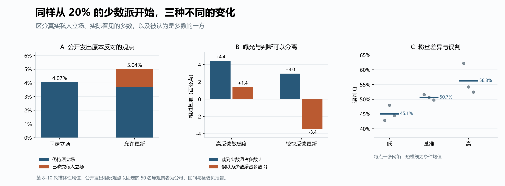

# 多数幻觉拓展实验审计与演示方案

2026-11-21 · gxy

独立检查了三份归档清单，并从 45 条轨迹复算逐轮的消息多数、感知误判、公开偏离与沉默。其中反馈回放覆盖基准、高反馈敏感度、较快反馈更新三组，私人立场回放覆盖全部 18 条。网络稳健性分析使用归档的逐图均值。审计沿用现有轨迹和冻结归档。 [诊断数据](../experiments/2026-11-21-ext-audit/diagnostics.json)

同一个问题贯穿三项实验：**谁在私下赞成，谁在公开发言，谁又被旁观者当成多数。** 演示先揭示初始全网比例，再给观众看信息流和公开表达，最后揭示旁观者估计。三个比例各有自己的分母。

## 拓展一｜坚持私人立场会减少公开偏离吗

现有设计给出了边界。固定条件下，私人立场与倡议者相反的观察者中，有 4.07% 公开表达了倡议立场；开放更新后，按当轮仍持原立场者计算是 3.95%。差异 −0.12 个百分点，95% CI [−0.42, +0.11]。因此这批数据没有显示坚持立场会减少公开偏离。两组使用同一个提示及行为系数，仅有 50 名观察者能在更新条件下改变私人立场。

换一个分母，故事就变了。固定考察同样 50 名原观察者，公开说出原先反对的观点从 4.07% 升到 5.04%。更新条件的 5.04% 中，3.70% 来自当轮仍持原立场者，1.33% 来自当轮发布前已改变立场者。九条更新轨迹共记录 29 次私人转变，末轮发布前全网真实反对比例平均 20.28%，第十轮结束后为 20.32%。这些是描述性回放。投影上可以先显示公开结果，让观众判断是否发生了顺从，再打开私人记录核对。现实中，匿名调查与公开表态的差距也提示，仅凭可见行为很难判断一个人是否真的改变了意见。 [Prentice 与 Miller 的校园规范研究](https://doi.org/10.1037/0022-3514.64.2.243)

**充分性。** 工程与轨迹完整。实验操纵是“允许改变立场”，与信念强度、表达代价或抗压能力不同。可作为补充机制和边界案例，尚不足以支撑“固执的人更不顺从”之类的人群解释。

**补证据。** 下轮将私人更新权限与表达情境分开操纵。冻结个人的初始和当轮立场，同时报告固定队列公开表达、仍持原立场者的公开偏离、匿名私下选择和沉默。优先在同一组观测经历下比较匿名与实名表达，避免两组的信息流先分叉后再把差异归因于公开压力。预先确定最小有意义差异，并用区间报告仍可能存在的效应。政治表达元分析支持“感知意见气候与表态有关”这一机制类比，相关系数不用于标定本模型。 [Matthes 等的元分析](https://doi.org/10.1177/0093650217745429)

## 拓展二｜评论区刷屏，为什么未必让人相信那一方人更多

强化反馈敏感度时，读到少数派消息占多数的观察者增加 4.4 个百分点，误以为少数派在全社区占多数的观察者只增加 1.4 个百分点。适度加快反馈更新时，两者甚至方向相反（J +3.0、Q −3.4 个百分点）。用两列并排显示“你刚看到的内容”和“你猜多少人持此观点”，比单独展示 Q 曲线更能回答问题。反馈学习模型解释了为什么回应会改变发言意愿，这里则进一步量出曝光和判断之间的距离。 [Gaisbauer 等的反馈学习模型](https://doi.org/10.3390/e24101484)

**充分性。** 五条件、同组冻结输入、同批重跑基准，具备方向性机制证据。原归档与新基准的 Q 相差 4.4 个百分点，量级接近处理差。各指标分开做四项 Holm 后均未达 0.05。旧报告从平均沉默率变化直接推断了传播中介；单凭这些数据无法区分退出发言的人、重复发言的作者和阅读抽样。

**补证据。** 先用现有归档复盘每轮发言者数量、少数派消息中不同作者的数量，以及观察者的连续接触。下一批只预定一个主对比，以固定阅读正文、消息立场比例与总条数为前提，对比“一人连续发四条”和“四人各发一条”，再决定是否跑全生态版本。它能直接检验同一方的声音变多以后，旁观者是否真的把它当成了更多的人。

## 拓展三｜少数派占比相同，为什么有些人身边更像多数

当真实少数派固定 20% 时，低、基准、高粉丝差异的 Q 分别为 45.1%、50.7%、56.3%。把三张网络各自作为点标出来，观众能看出均值递增，也能自行判断网络之间的离散程度。现实中的关注关系让某些声音被许多人重复采样，所以可见声量和人数不必同步。网络拓扑研究发现，度分布异质性与连接偏好共同影响这种失真。 [Lerman 等的多数幻觉研究](https://doi.org/10.1371/journal.pone.0147617)

**充分性。** 这是当前最适合演示的拓展，证据尚不足以推广到一般网络。每个条件只有三张独立图，九条轨迹来自图内重复。重新选择 TH 位置后，拓扑与位置选择的影响共同进入比较。任取两张处理图与两张基准图，低粉丝差异的平均 Q 差在 −7.4 至 −4.0 个百分点，高粉丝差异在 +2.2 至 +8.0 个百分点，方向在这批图中稳定。跨社群连接权重的两个极端条件均低于中间基准，最高跨社群条件下仍有一张图高于所有基准图，因此“越跨圈越能纠偏”没有得到支持。NW1 有一条轨迹按修订案换过组种子，两次失败记录仍在归档。

**补证据。** 首先用复用底层网络随机数、社团成员、观察者和倡议者名单的成对网络做控制，保持总体度数接近，记录实际跨社群边比例、粉丝分布、普通节点覆盖和作者重复曝光。只把“高低粉丝差异下的 Q 差”作为第一主比较。每个新网络是一组独立重复。固定名单作为主分析，重选 TH 作为敏感性分析。跨社群权重暂保留非线性假设，收集多个预定梯度。

## 审计中发现的统计口径

- **个体抵抗力。** 冻结协议规定对 Q、J、公开偏离、沉默四个结果一起做 Holm，旧脚本按每个指标只有一个对比，导致旧报告把原始 p 标为 Holm p。用冻结协议重算，四项校正后均为 1.0000。差值与区间保持原计算，持续性单列。新结果和算法检查保存于诊断数据，旧归档仍可按原校验清单校验。
- **网络环境。** 原实现将未中心化 bootstrap 差值落在零两侧的尾部比例作为双侧量。它反映这些固定图的图内重采样，无法替代以独立网络为单位的检验。假设六张图的标签可交换，两条件各三张的双侧置换检验最小 p 为 0.10。归档中的历史基准图与新生成图来源不同，因此审计中的假设性置换仅作样本尺度诊断。
- **展示图。** 原轨迹图的阴影按条件重采样整条轨迹，图中的点态阴影和正文的图内分层对比不应互换。现场展示原图时标清描述性质。新的三联图保留了准确分母、对照和网络级散点，完整差值区间仍查正文与诊断数据。

## 哪些新实验值得在演示中保留

| 顺序 | 实验 | 演示画面与可证伪结果 | 最低可用版本 |
|---|---|---|---|
| 1 | 重复作者与人数线索 | 两组读到多数立场和正文完全相同。一组是同一作者反复发言，一组是不同作者。显示作者去重前后的估计，再揭示两组真实人数。若没有差异，可排除这一刺激下的作者重复效应。 | 从冻结消息库构造配对输入。读者、文本顺序和立场占比固定。 |
| 2 | 同一网络，不同推荐流 | 同一个人同时看到两个信息流。逐阅读位置按 η=0、0.3、0.6 选择关注池或推荐池，池空回退、去重，再按社团权重抽样。展示推荐前后接触到的独立作者及 Q，而非单看推荐量。也允许各条件 Q 接近。 | 先固定发布记录回放，只换阅读策略。通过再开放发布反馈。 |
| 3 | 实名公开表态与匿名私下选择 | 现场让观众分别猜“多少人公开说”和“多少人私下赞成”，对照同一观察者的立场、表达和沉默。可检验改变匿名性是否只改变表达。 | 先用虚构议题和两种受众设定。跨真实议题与模型复测属于后续稳健性。 |

实证中也曾出现“换信息流改变曝光，但未检出态度变化”。所以演示的价值来自把变化发生在哪一层画清楚，即便主要判断没有明显变化，这个实验仍能回答问题。 [Guess 等的信息流随机干预](https://doi.org/10.1126/science.abp9364)

## Git 路线与合并门槛

| 分支 | 当前处理 |
|---|---|
| `main` | 作为整合目标，先保留初始框架。汇总证据后从此分支新开评审分支。 |
| `lrf` | 保留主实验一的冻结基线与历史归档。位置效应用补充验证报告对照，归档身份照原样核验。 |
| `lrf-feature-wzt`、`zjy/exp1-position-analysis` | 作为同学交接点保留。后续批次结果分别进入 GXY 的续接分支。 |
| `gxy-main2-validation`、`gxy-exp1-supplement` | 两批技术试跑已审计并推送，正式批次进行中。完成后分别审阅完整性、模型一致性、用量和可解释性，再评估主线报告。 |
| `gxy` | 保留三项拓展的可复现归档与本次审计。前三个候选按顺序在独立实验分支验证，诊断结果可以复用。 |

进入 `main` 的候选需同时满足三个条件。它回答已有实验无法回答的问题，有预先确定的主对比与最小有意义差异。冻结协议、完整轨迹、独立复算、推断口径和图表能够互相核对。结论能用一句话和一张图讲清现实意义、方向及适用边界。方向稳定的效应和足够精确的近零结果均可作为证据。每项由评审分支择取必要代码、报告和归档链接，完整调用历史留在各实验归档分支。这次先推送审计与表达改进，暂不合并到 `main`。

复算与重建证据图可用 `python -B -m scripts.audit_extensions --output experiments/2026-11-21-ext-audit`。
