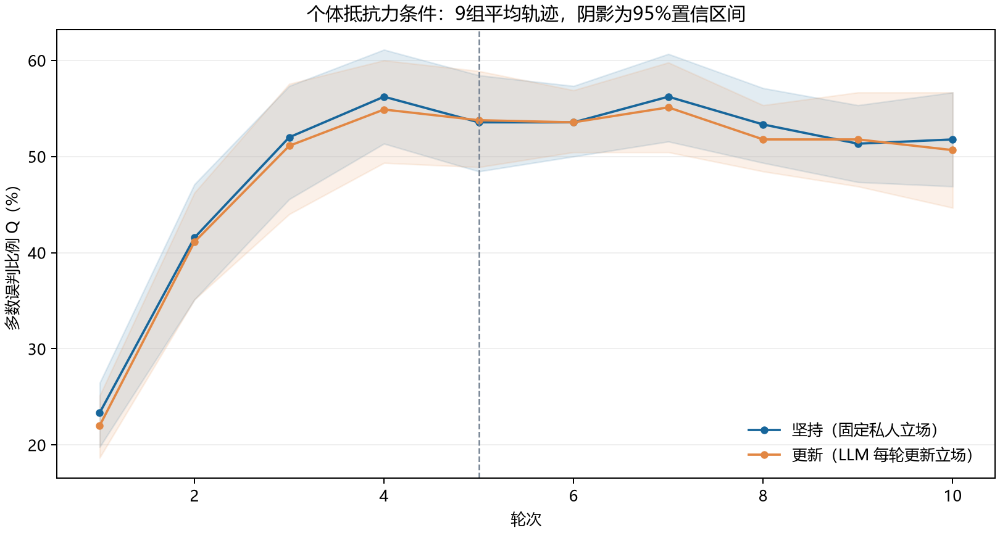
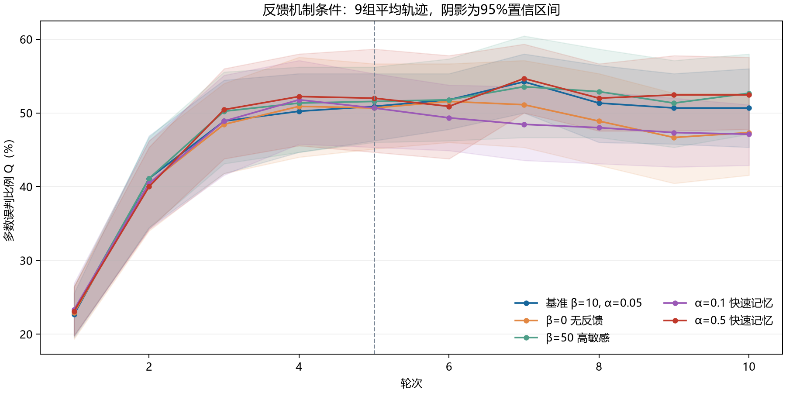
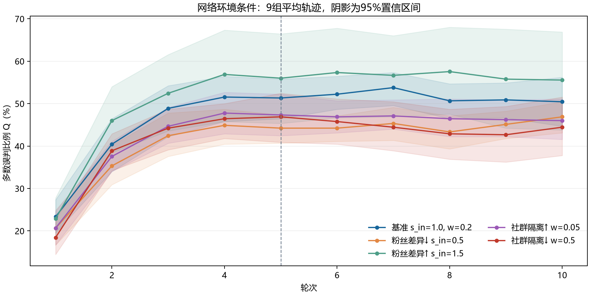
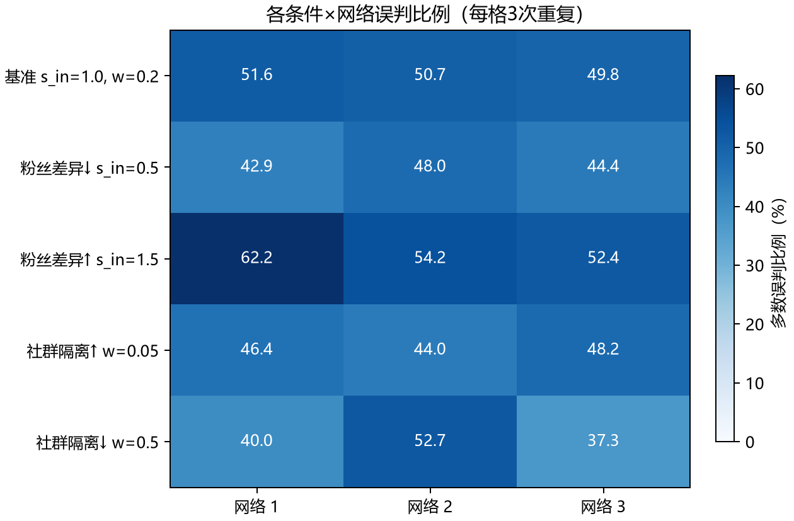

# 多数幻觉拓展实验 v1｜完整方案与结果

本版本共 108 条真实模型轨迹，每条 10 轮。本文自包含本版本规则、三项实验和最终数据解释。另一版本见[独立报告](拓展实验方案与结果.md)。

私人立场更新、反馈参数和网络结构构成本版本三个问题。

## 研究问题与共同设置

在支持倡议立场的人始终占少数的模拟社区里，私人立场、公开表达和局部接触如何共同塑造“谁是多数”的判断？议题固定为 2024 年美国总统大选投票前是否支持特朗普当选，倡议者公开反对。模型估计的是支持当选的人数比例。

每条轨迹包含 1000 个节点、200 名倡议者、50 名固定观察者。基准采用三张网络、每张三组个人参数，形成九个完整运行单位。社团规模为 150、200、250、400，期望有向边数 12000。文本库含双方各 25 条原创，每条各两条赞同与反对评论，共 250 条冻结文本。倡议者与观察者集合互斥。

关注关系从节点指向其关注的作者。出向活跃权重和被关注权重分别服从均值为一的对数正态分布。

$$
x_i\sim\operatorname{LogNormal}(-s_{\mathrm{out}}^2/2,s_{\mathrm{out}}^2),\qquad y_j\sim\operatorname{LogNormal}(-s_{\mathrm{in}}^2/2,s_{\mathrm{in}}^2).
$$

社团内相对连边权重为一，社团间为 $w$，连边概率为

$$
P(i\to j)=1-\exp(-\lambda x_iy_j\omega_{ij}),\qquad i\ne j.
$$

$\lambda$ 用二分法调节至期望边数 12000，实际边数接受区间为 11400–12600。抽样要求每个节点至少关注一人且网络弱连通。观察者按社团和粉丝数分层抽取。TH 按结构多数幻觉指标构造，其来源位置搜索保留社团与立场强度配额，并按约 5% 容差匹配候选资源；结构筛选本身不作为感知效应证据。

基准参数为 $\rho=6$、$\kappa=0.5$、$\gamma=1$、$\alpha=0.05$、$\beta=10$，$\boldsymbol\theta=(1,0,-1,0)$。个人基准活跃度服从 $\operatorname{Beta}(0.24,0.85)$，立场强度 $h_i\in\{0.4,0.8\}$ 各半。每轮先同步发布消息，再阅读、更新判断与反馈、决定下一轮行动。LLM 感知温度为零，请求模型为 `deepseek-v4-flash`，请求与返回模型标识分别保存在调用日志里。

## 行为机制和指标

节点 $i$ 的私人立场记作 $s_i\in\{-1,+1\}$，对支持议题人数比例的判断记作 $\hat p_{i,t}$。反馈状态使用 $F$ 表示，以便与误判比例 $Q_{\mathrm{ill}}$ 区分。

$$
\sigma(x)=\frac{1}{1+e^{-x}},\qquad
F_{i,t}=(1-\alpha)F_{i,t-1}+\alpha\frac{n^+_{i,t}-n^-_{i,t}}{1+n^+_{i,t}+n^-_{i,t}}.
$$

其中 $n^+$ 和 $n^-$ 分别为本轮收到的赞同和反对原帖的评论通知数。是否发言的概率为

$$
g_{i,t}=\sigma\left(\log\frac{g_{0i}}{1-g_{0i}}+\beta F_{i,t}+a_i\log\rho\right),
$$

$a_i$ 标记倡议者。感知逆风程度及发言后选择评论的概率为

$$
d_{i,t}=\frac{1-s_i(2\hat p_{i,t}-1)}{2},\qquad
c_{i,t}=\sigma(\theta_0+\theta_hh_i+\theta_dd_{i,t}+\theta_{hd}h_id_{i,t}).
$$

有可评论目标且已决定发言时，选择评论的概率是 $c$，选择原创的概率是 $1-c$。因此改变 $\theta_d$ 会重新分配评论和原创。沉默首先由 $g$ 决定，后续才可能经反馈产生间接变化。对立场为 $s_j$ 的目标原帖，普通节点赞同的概率是

$$
P(\mathrm{agree}\mid i,j,t)=\sigma\left(2s_j\left[\kappa s_ih_i+\gamma(2\hat p_{i,t}-1)\right]\right).
$$

倡议者始终公开支持其倡议立场。评论的赞同或反对首先相对于原帖定义，转换后才得到议题方向。

令观察者集合为 $O$，实际读到的消息为 $R_{i,t}$。本实验以反对议题的一方作为倡议少数派，指标为

$$
Q_{\mathrm{ill},t}=\frac{1}{|O|}\sum_{i\in O}\mathbf{1}(\hat p_{i,t}<0.5),
$$

$$
J_t=\frac{1}{|O|}\sum_{i\in O}\mathbf{1}\left(\sum_{m\in R_{i,t}}\mathbf{1}(s_m=-1)>\frac{|R_{i,t}|}{2}\right).
$$

$Q_{\mathrm{ill}}$ 衡量认为少数派占多数的观察者比例，$J$ 衡量本轮阅读内容以少数派立场为多数的观察者比例。恰好一半计为无多数，空阅读的 $J$ 为零，已有感知继续进入 $Q_{\mathrm{ill}}$。

当轮私人立场与倡议者相反的观察者集合记为 $O_t^+$。$C$ 是其中公开表达倡议立场者的比例，$S^{-}$ 是其中没有任何公开消息者的比例。$S^{-}$ 的减号沿用项目字段名称，分母在当前设定下是私人支持议题的观察者。

令 $b_{i,t}$ 表示本轮归档判定的公开立场，$Z_{i,t}$ 标记本轮至少发布一条消息，节点比例写为

$$
C_t=\frac{\sum_{i\in O_t^+}\mathbf{1}(Z_{i,t}=1,\ b_{i,t}=-1)}{|O_t^+|},\qquad
S_t^{-}=\frac{\sum_{i\in O_t^+}\mathbf{1}(Z_{i,t}=0)}{|O_t^+|}.
$$

本版 $b$ 的选取由相应网络规则定义，分母采用消息发布前的私人立场。

## 推断与图表口径

同网络、同个人参数、同 TH 名单、同组随机流的对照使用配对比较。在每张固定网络内按完整配对组 bootstrap 10000 次，报告点态 95% 区间；精确符号翻转检验假设原假设下组差可交换，Holm 校正的检验族在各实验内明确规定。节点和轮次均不作为独立样本。

网络条件的网络不同，采用各条件独立的固定图内重采样。归档双侧量计算未中心化 bootstrap 差值落在零两侧的比例，校正后值仍然以这批固定图为条件。它没有包含重新抽网络的不确定性。表中“零次跨零”表示 10000 次重采样中未落到另一侧，证据分辨率约为万分之一。每个条件的独立网络只有三张。

图中的曲线表示条件均值，已有轨迹图的阴影为描述性点态区间，不能直接用于判断处理差显著性。结论以配对表、检验族和网络级范围为准。现实场景用于解释模型机制，实际人群的心理参数仍需独立数据验证。

## 本版本网络规则

阅读窗口为最近两轮，最多无放回抽取五条可见消息。非观察者的感知状态在实际阅读时设为 $0.5$，其行为关闭 $\gamma$、$\theta_d$、$\theta_{hd}$ 项。LLM 只为观察者估计感知。每个节点每轮产生至多一条原创或评论。主实验私人立场固定，个体抵抗力实验的更新条件允许观察者在轮末提交新立场，供下一轮使用。

本版本主要汇总窗口为第 8–10 轮。

$$
\overline Q_{8:10}=\frac{1}{3}\sum_{t=8}^{10}Q_{\mathrm{ill},t},\qquad
D_{\mathrm{time}}=\overline Q_{8:10}-\overline Q_{3:5}.
$$

时间差刻画后期较前期的变化。十轮结束时的均值和一次时间差不能单独证明长期收敛。

## 拓展一　私人立场更新与公开偏离

### 方案

R0 固定私人立场，R1 允许观察者根据 LLM 返回的新立场更新。两组使用相同的四字段提示；R0 解析后忽略新立场，R1 应用。倡议者及其余非观察节点私人立场固定。三张网络、每张三组，两条件共 18 条十轮轨迹。四指标共同构成一个 Holm 检验族，持续性单列。

### 条件均值

| 条件 | $Q_{\mathrm{ill}}$ | $J$ | $C$ | $S^{-}$ |
| --- | --- | --- | --- | --- |
| R0 | 52.15% | 49.33% | 4.07% | 78.07% |
| R1 | 51.41% | 49.56% | 3.95% | 78.32% |

### 配对结果

以下校正按协议的四指标联合检验族计算。差值、点态区间和原始 p 使用归档数值。

| 指标 | 比较 | 差值（百分点） | 95% 区间（百分点） | 原始双侧量 | Holm 校正 |
| --- | --- | --- | --- | --- | --- |
| $Q_{\mathrm{ill}}$ | R1 − R0 | -0.74 | [-2.74, +0.81] | 0.8125 | 1.0000 |
| $J$ | R1 − R0 | +0.22 | [-0.67, +0.96] | 0.7812 | 1.0000 |
| $C$ | R1 − R0 | -0.12 | [-0.42, +0.11] | 0.5781 | 1.0000 |
| $S^{-}$ | R1 − R0 | +0.25 | [-0.07, +0.54] | 0.3594 | 1.0000 |

### 后期变化

| 比较 | 增长差（百分点） | 95% 区间（百分点） | 原始双侧量 | Holm 校正 |
| --- | --- | --- | --- | --- |
| R1 − R0 | -0.07 | [-1.85, +1.33] | 1.0000 | 1.0000 |

### 机制解释与现实映射

两条件末三轮 Q 分别为 52.15% 和 51.41%，C 分别为 4.07% 和 3.95%。允许更新没有显示可辨别的公开偏离或多数误判变化，四个主要指标的联合 Holm 值均为 1。该结论只涉及这套允许更新机制。

九条更新轨迹共 29 次私人立场转变，全都转向倡议方。第十轮发布前真实反对方比例平均 20.28%，第十轮结束后的状态为 20.32%。当时仍持原立场者的 C 和固定原观察者群体的公共表态是不同分母。归档回放中，同一批原观察者公开表达倡议立场从 4.07% 变为 5.04%，其中 1.33% 来自当轮发布前已转变私人立场者。

现实中，公开表达的改变可能来自社会压力，也可能来自私人意见改变。使用匿名问卷追踪同一批人有助于区分这两种机制。本设计允许更新的范围只覆盖 50 名观察者，不能用这些均值判断真实人群里“越坚持越少顺从”。



图 1　固定与更新私人立场的十轮 Q 轨迹；曲线为九个组的均值。

## 拓展二　反馈敏感度与反馈更新速度

### 方案

FB0 为 $\beta=10,\alpha=0.05$，FB1 设 $\beta=0$，FB2 设 $\beta=50$，FB3 设 $\alpha=0.1$，FB4 设 $\alpha=0.5$。每次只改一个参数。五条件各九条轨迹，共 45 条，组内共享网络、个人参数、TH 名单和组随机流。每指标的四个相对基准对比构成 Holm 检验族，增长差另成一族。

### 条件均值与配对结果

| 条件 | $Q_{\mathrm{ill}}$ | $J$ | $C$ | $S^{-}$ |
| --- | --- | --- | --- | --- |
| FB0 | 50.89% | 49.04% | 4.15% | 78.15% |
| FB1 | 47.63% | 48.37% | 3.63% | 77.93% |
| FB2 | 52.30% | 53.48% | 3.41% | 79.33% |
| FB3 | 47.48% | 52.00% | 3.11% | 78.59% |
| FB4 | 52.30% | 48.81% | 2.96% | 78.52% |

| 指标 | 比较 | 差值（百分点） | 95% 区间（百分点） | 原始双侧量 | Holm 校正 |
| --- | --- | --- | --- | --- | --- |
| $Q_{\mathrm{ill}}$ | FB1 − FB0 | -3.26 | [-6.15, -0.37] | 0.1211 | 0.3633 |
| $Q_{\mathrm{ill}}$ | FB2 − FB0 | +1.41 | [-0.59, +3.26] | 0.2930 | 0.4844 |
| $Q_{\mathrm{ill}}$ | FB3 − FB0 | -3.41 | [-5.70, -0.96] | 0.0703 | 0.2812 |
| $Q_{\mathrm{ill}}$ | FB4 − FB0 | +1.41 | [-0.00, +2.89] | 0.2422 | 0.4844 |
| $J$ | FB1 − FB0 | -0.67 | [-4.07, +3.04] | 0.7695 | 1.0000 |
| $J$ | FB2 − FB0 | +4.44 | [+1.48, +7.56] | 0.0391 | 0.1562 |
| $J$ | FB3 − FB0 | +2.96 | [-0.52, +6.67] | 0.2617 | 0.7852 |
| $J$ | FB4 − FB0 | -0.22 | [-4.07, +3.48] | 0.9453 | 1.0000 |
| $C$ | FB1 − FB0 | -0.52 | [-1.19, +0.15] | 0.3125 | 0.3125 |
| $C$ | FB2 − FB0 | -0.74 | [-1.11, -0.44] | 0.0156 | 0.0625 |
| $C$ | FB3 − FB0 | -1.04 | [-1.70, -0.44] | 0.0625 | 0.1875 |
| $C$ | FB4 − FB0 | -1.19 | [-1.93, -0.37] | 0.0820 | 0.1875 |
| $S^{-}$ | FB1 − FB0 | -0.22 | [-0.52, +0.07] | 0.5000 | 1.0000 |
| $S^{-}$ | FB2 − FB0 | +1.19 | [+0.52, +1.78] | 0.0312 | 0.1250 |
| $S^{-}$ | FB3 − FB0 | +0.44 | [-0.07, +0.96] | 0.4141 | 1.0000 |
| $S^{-}$ | FB4 − FB0 | +0.37 | [-0.07, +0.81] | 0.4844 | 1.0000 |

### 后期增长差

| 比较 | 增长差（百分点） | 95% 区间（百分点） | 原始双侧量 | Holm 校正 |
| --- | --- | --- | --- | --- |
| FB1 − FB0 | -3.26 | [-6.89, +0.22] | 0.1875 | 0.5625 |
| FB2 − FB0 | +0.37 | [-1.48, +2.30] | 0.7812 | 1.0000 |
| FB3 − FB0 | -3.85 | [-6.00, -1.48] | 0.0703 | 0.2812 |
| FB4 − FB0 | -0.15 | [-2.37, +2.37] | 0.9688 | 1.0000 |



图 2　反馈条件的 10 轮 Q 均值轨迹；主要窗口为第 8–10 轮。

### 机制解释与现实映射

高反馈敏感度的 J 比基准高 4.44 个百分点，Q 高 1.41 个百分点。适度加快更新的 J 高 2.96 个百分点，Q 反而低 3.41 个百分点。所有 Q、J、C、沉默对比经各指标内 Holm 校正均未达到 0.05。方向可以用于讨论曝光和人数判断的差别，仍需更多重复确认。

反馈基准 Q 为 50.89%，原主实验一历史 TH 为 46.52%。历史批次同时具有运行器与模型路由差异，反馈对比使用本批重跑基准。4.37 个百分点的跨批差并未被分解为可识别的单一原因。

现实类比是，评论区的回复会改变人们继续发言的意愿，而更多某一方消息与更高的多数人数估计之间仍隔着读者判断。平均 J 和 Q 的方向无法单独确证“某类人退出讨论”的中介作用，需要作者级轨迹和实际接触记录。

## 拓展三　粉丝差异与跨社群连接

### 方案

NW0 为 $s_{\mathrm{in}}=1,w=0.2$；NW1、NW2 将 $s_{\mathrm{in}}$ 改为 $0.5$、$1.5$；NW3、NW4 将 $w$ 改为 $0.05$、$0.5$。$s_{\mathrm{in}}$ 控制粉丝吸引力的异质性，$w$ 是跨社群连边的相对权重。它与最终实现的跨社群边比例需要区分。

基准复用三张主实验网络，四个新条件各生成三张网络并重做 TH 名单搜索，共 15 张图、45 条轨迹。每个新条件三张图乘三组个人参数。同条件各运行的三图等权，跨条件分析按固定图内重采样。

### 条件均值与固定图内对比

| 条件 | $Q_{\mathrm{ill}}$ | $J$ | $C$ | $S^{-}$ |
| --- | --- | --- | --- | --- |
| NW0 | 50.67% | 49.04% | 4.07% | 78.15% |
| NW1 | 45.11% | 49.93% | 3.70% | 77.85% |
| NW2 | 56.30% | 53.41% | 4.22% | 77.48% |
| NW3 | 46.22% | 46.52% | 4.37% | 79.33% |
| NW4 | 43.33% | 46.81% | 3.26% | 78.30% |

| 指标 | 比较 | 差值（百分点） | 95% 区间（百分点） | 原始双侧量 | Holm 校正 |
| --- | --- | --- | --- | --- | --- |
| $Q_{\mathrm{ill}}$ | NW1 − NW0 | -5.56 | [-11.04, -0.30] | 0.0361 | 0.1083 |
| $Q_{\mathrm{ill}}$ | NW2 − NW0 | +5.63 | [-5.56, +17.85] | 0.3580 | 0.3580 |
| $Q_{\mathrm{ill}}$ | NW3 − NW0 | -4.44 | [-10.59, +1.70] | 0.1549 | 0.3098 |
| $Q_{\mathrm{ill}}$ | NW4 − NW0 | -7.33 | [-13.41, -1.04] | 0.0199 | 0.0796 |
| $J$ | NW1 − NW0 | +0.89 | [-3.63, +5.48] | 0.7188 | 0.9915 |
| $J$ | NW2 − NW0 | +4.37 | [-0.81, +9.63] | 0.1000 | 0.4000 |
| $J$ | NW3 − NW0 | -2.52 | [-7.33, +2.52] | 0.3305 | 0.9915 |
| $J$ | NW4 − NW0 | -2.22 | [-7.63, +3.41] | 0.4428 | 0.9915 |
| $C$ | NW1 − NW0 | -0.37 | [-1.85, +0.96] | 0.6550 | 1.0000 |
| $C$ | NW2 − NW0 | +0.15 | [-1.26, +1.48] | 0.8076 | 1.0000 |
| $C$ | NW3 − NW0 | +0.30 | [-1.33, +1.93] | 0.6987 | 1.0000 |
| $C$ | NW4 − NW0 | -0.81 | [-2.22, +0.52] | 0.2803 | 1.0000 |
| $S^{-}$ | NW1 − NW0 | -0.30 | [-2.96, +2.15] | 0.8380 | 1.0000 |
| $S^{-}$ | NW2 − NW0 | -0.67 | [-4.30, +2.74] | 0.7258 | 1.0000 |
| $S^{-}$ | NW3 − NW0 | +1.19 | [-2.22, +4.59] | 0.5205 | 1.0000 |
| $S^{-}$ | NW4 − NW0 | +0.15 | [-3.41, +3.93] | 0.9619 | 1.0000 |

### 后期增长差

| 比较 | 增长差（百分点） | 95% 区间（百分点） | 原始双侧量 | Holm 校正 |
| --- | --- | --- | --- | --- |
| NW1 − NW0 | +1.19 | [-2.96, +5.19] | 0.5663 | 1.0000 |
| NW2 − NW0 | +1.11 | [-3.41, +5.78] | 0.6375 | 1.0000 |
| NW3 − NW0 | -0.44 | [-3.41, +2.74] | 0.7694 | 1.0000 |
| NW4 − NW0 | -2.59 | [-5.93, +0.89] | 0.1492 | 0.5968 |



图 3　网络条件的 Q 均值轨迹。



图 4　每条件三张网络的后期 Q；每格三个完整运行。

### 机制解释与现实映射

低、基准、高粉丝差异条件的 Q 为 45.11%、50.67%、56.30%。跨社群连接低、高条件为 46.22%、43.33%，两者均低于中间基准。四项 Q 比较经原分析的 Holm 校正均未达到 0.05。

现实中，少数高关注账号可同时出现在大量人的关注列表里，使全网少数立场在本地反复可见。跨社群连接既能增加传播覆盖，也能带来相反声音。两个极端权重均低于中间基准的结果提示检查非线性关系，不能推导“连接越多越能纠偏”或“隔离越强越容易误判”。

本实验每次改变拓扑后重挑 TH，同时改变了被观察节点与人物参数。描述的是这套生成网络和位置选择机制的整体变化。每条件仅三张图限制了普适解释。

## 数据、调用用量与复核

- expression 的[冻结协议](../experiments/2026-11-20-ext-resistance/protocol.json)、[完整结果](../experiments/2026-11-20-ext-resistance/results.json)、[推断](../experiments/2026-11-20-ext-resistance/inference.json)和[校验清单](../experiments/2026-11-20-ext-resistance/archive_manifest.json)。
- feedback 的[冻结协议](../experiments/2026-11-20-ext-feedback/protocol.json)、[完整结果](../experiments/2026-11-20-ext-feedback/results.json)、[推断](../experiments/2026-11-20-ext-feedback/inference.json)和[校验清单](../experiments/2026-11-20-ext-feedback/archive_manifest.json)。
- network 的[冻结协议](../experiments/2026-11-20-ext-network/protocol.json)、[完整结果](../experiments/2026-11-20-ext-network/results.json)、[推断](../experiments/2026-11-20-ext-network/inference.json)和[校验清单](../experiments/2026-11-20-ext-network/archive_manifest.json)。

| 实验 | 实际请求 | 已知输入 Token | 已知输出 Token | 缺失 usage | 格式错误记录 | API 错误记录 | 复用记录 | 响应标识 |
| --- | --- | --- | --- | --- | --- | --- | --- | --- |
| expression | 8,850 | 28,062,935 | 777,948 | 0 | 117 | 0 | 43 | deepseek-flash |
| feedback | 22,228 | 67,753,469 | 1,839,957 | 361 | 53 | 361 | 0 | deepseek-flash |
| network | 22,697 | 70,425,496 | 1,911,466 | 2 | 57 | 2 | 0 | deepseek-flash |

复用记录不计入新请求。已知 Token 是有 usage 的请求之和，缺失不按零消耗解释。调用日志记录实际模型路由，单一响应名称不保证底层服务永久不变。

## 完成状态与结论边界

本版本 108 条轨迹全部保存十轮结果。反馈与私人立场实验按固定图内配对解释；网络结果按固定图内重采样解释。私人更新的四指标联合 Holm 已在本文按协议重算。原始归档数值和文件保留用于校验。

三张固定图上的更多个人参数组提高图内重复能力。主实验初始化本身经过筛选，因而结论条件包括题材、文本、参数起点和位置算法。现实类比帮助解释机制；真实选民行为、人格差异和平台干预效果需另外的实证设计。

## 复现方法

使用本版本归档对应的历史源码工作树。反馈协议记录的运行器在提交 `7a7b2dd`，网络与私人更新的运行器在 `15ef74d`，源码指纹以各自 protocol.json 为准。冻结归档的文本字节包含 Windows 换行；使用清单校验或核对 Git 规范化换行后再恢复。

```powershell
python -B -m unittest discover -s tests
python -B -m scripts.ext_feedback analyze
python -B -m scripts.ext_network analyze
python -B -m scripts.ext_resistance conversions
python -B -m scripts.ext_resistance analyze
```

发起新真实运行时，先冻结到新的独占结果目录，并登记当前源码、提示、模型配置和输入指纹。现有完成目录的 run 入口会复用结果；更换模型或网络规则时应先重新构建协议和任务身份。密钥由进程环境或本地受忽略的配置提供。


## 参考文献

- 局部观察和网络度异质性如何放大全局少数立场。[Lerman 等，2016](https://doi.org/10.1371/journal.pone.0147617)
- 社会反馈如何改变表达和沉默的理论模型。[Gaisbauer 等，2022](https://doi.org/10.3390/e24101484)
- 感知意见支持与政治表达关系的元分析。[Matthes 等](https://doi.org/10.1177/0093650217745429)
- 私人态度与感知公共规范的差异。[Prentice 与 Miller，1993](https://doi.org/10.1037/0022-3514.64.2.243)
