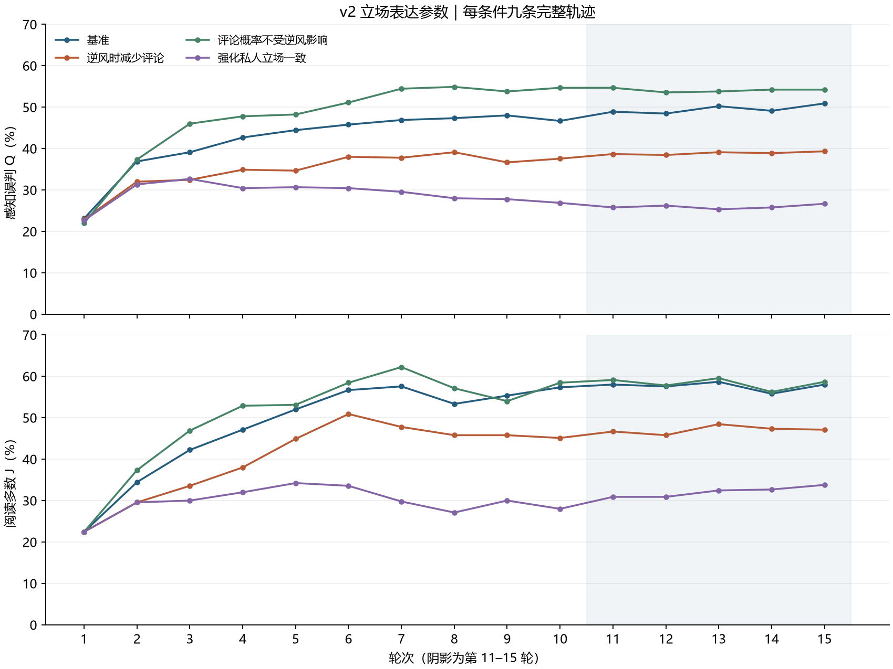
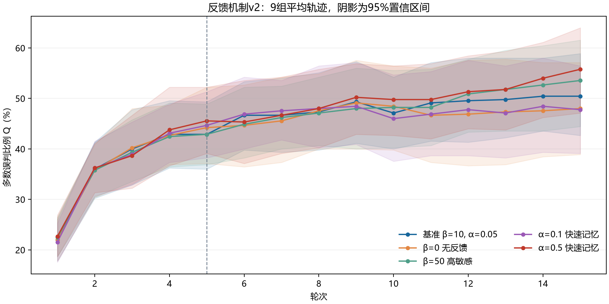
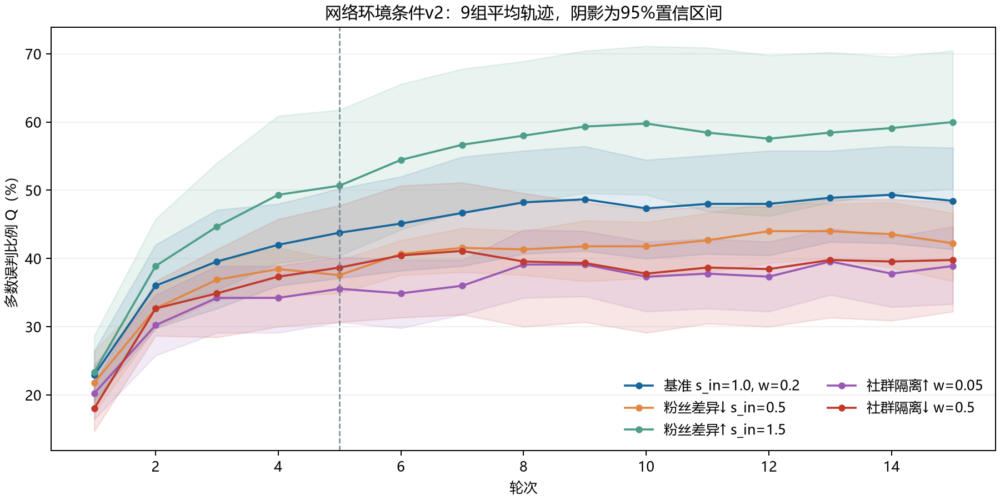
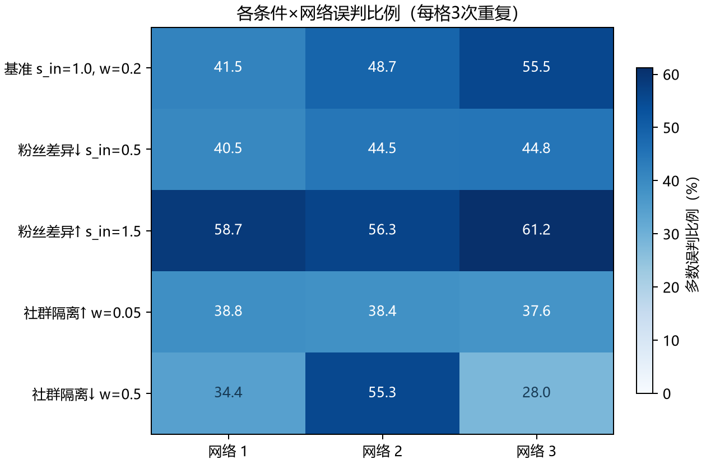

# 多数幻觉拓展实验 v2｜完整方案与结果

本版本共 126 条真实模型轨迹，每条 15 轮。本文自包含本版本规则、三项实验和最终数据解释。另一版本见[独立报告](拓展实验方案与结果-v1.md)。

立场表达参数、反馈参数和网络结构构成本版本三个问题。

## 研究问题与共同设置

在支持倡议立场的人始终占少数的模拟社区里，私人立场、公开表达和局部接触如何共同塑造“谁是多数”的判断？议题固定为 2024 年美国总统大选投票前是否支持特朗普当选，倡议者公开反对。模型估计的是支持当选的人数比例。

每条轨迹包含 1000 个节点、200 名倡议者、50 名固定观察者。基准采用三张网络、每张三组个人参数，形成九个完整运行单位。社团规模为 150、200、250、400，期望有向边数 12000。文本库含双方各 25 条原创，每条各两条赞同与反对评论，共 250 条冻结文本。倡议者与观察者集合互斥。

关注关系从节点指向其关注的作者。出向活跃权重和被关注权重分别服从均值为一的对数正态分布。

$$
x_i\sim\operatorname{LogNormal}(-s_{\mathrm{out}}^2/2,s_{\mathrm{out}}^2),\qquad y_j\sim\operatorname{LogNormal}(-s_{\mathrm{in}}^2/2,s_{\mathrm{in}}^2).
$$

社团内相对连边权重为一，社团间为 $w$，连边概率为

$$
P(i\to j)=1-\exp(-\lambda x_iy_j\omega_{ij}),\qquad i\ne j.
$$

$\lambda$ 用二分法调节至期望边数 12000，实际边数接受区间为 11400–12600。抽样要求每个节点至少关注一人且网络弱连通。观察者按社团和粉丝数分层抽取。TH 按结构多数幻觉指标构造，其来源位置搜索保留社团与立场强度配额，并按约 5% 容差匹配候选资源；结构筛选本身不作为感知效应证据。

基准参数为 $\rho=6$、$\kappa=0.5$、$\gamma=1$、$\alpha=0.05$、$\beta=10$，$\boldsymbol\theta=(1,0,-1,0)$。个人基准活跃度服从 $\operatorname{Beta}(0.24,0.85)$，立场强度 $h_i\in\{0.4,0.8\}$ 各半。每轮先同步发布消息，再阅读、更新判断与反馈、决定下一轮行动。LLM 感知温度为零，请求模型为 `deepseek-v4-flash`，请求与返回模型标识分别保存在调用日志里。

## 行为机制和指标

节点 $i$ 的私人立场记作 $s_i\in\{-1,+1\}$，对支持议题人数比例的判断记作 $\hat p_{i,t}$。反馈状态使用 $F$ 表示，以便与误判比例 $Q_{\mathrm{ill}}$ 区分。

$$
\sigma(x)=\frac{1}{1+e^{-x}},\qquad
F_{i,t}=(1-\alpha)F_{i,t-1}+\alpha\frac{n^+_{i,t}-n^-_{i,t}}{1+n^+_{i,t}+n^-_{i,t}}.
$$

其中 $n^+$ 和 $n^-$ 分别为本轮收到的赞同和反对原帖的评论通知数。是否发言的概率为

$$
g_{i,t}=\sigma\left(\log\frac{g_{0i}}{1-g_{0i}}+\beta F_{i,t}+a_i\log\rho\right),
$$

$a_i$ 标记倡议者。感知逆风程度及发言后选择评论的概率为

$$
d_{i,t}=\frac{1-s_i(2\hat p_{i,t}-1)}{2},\qquad
c_{i,t}=\sigma(\theta_0+\theta_hh_i+\theta_dd_{i,t}+\theta_{hd}h_id_{i,t}).
$$

有可评论目标且已决定发言时，选择评论的概率是 $c$，选择原创的概率是 $1-c$。因此改变 $\theta_d$ 会重新分配评论和原创。沉默首先由 $g$ 决定，后续才可能经反馈产生间接变化。对立场为 $s_j$ 的目标原帖，普通节点赞同的概率是

$$
P(\mathrm{agree}\mid i,j,t)=\sigma\left(2s_j\left[\kappa s_ih_i+\gamma(2\hat p_{i,t}-1)\right]\right).
$$

倡议者始终公开支持其倡议立场。评论的赞同或反对首先相对于原帖定义，转换后才得到议题方向。

令观察者集合为 $O$，实际读到的消息为 $R_{i,t}$。本实验以反对议题的一方作为倡议少数派，指标为

$$
Q_{\mathrm{ill},t}=\frac{1}{|O|}\sum_{i\in O}\mathbf{1}(\hat p_{i,t}<0.5),
$$

$$
J_t=\frac{1}{|O|}\sum_{i\in O}\mathbf{1}\left(\sum_{m\in R_{i,t}}\mathbf{1}(s_m=-1)>\frac{|R_{i,t}|}{2}\right).
$$

$Q_{\mathrm{ill}}$ 衡量认为少数派占多数的观察者比例，$J$ 衡量本轮阅读内容以少数派立场为多数的观察者比例。恰好一半计为无多数，空阅读的 $J$ 为零，已有感知继续进入 $Q_{\mathrm{ill}}$。

当轮私人立场与倡议者相反的观察者集合记为 $O_t^+$。$C$ 是其中公开表达倡议立场者的比例，$S^{-}$ 是其中没有任何公开消息者的比例。$S^{-}$ 的减号沿用项目字段名称，分母在当前设定下是私人支持议题的观察者。

令 $b_{i,t}$ 表示本轮归档判定的公开立场，$Z_{i,t}$ 标记本轮至少发布一条消息，节点比例写为

$$
C_t=\frac{\sum_{i\in O_t^+}\mathbf{1}(Z_{i,t}=1,\ b_{i,t}=-1)}{|O_t^+|},\qquad
S_t^{-}=\frac{\sum_{i\in O_t^+}\mathbf{1}(Z_{i,t}=0)}{|O_t^+|}.
$$

本版 $b$ 的选取由相应网络规则定义，分母采用消息发布前的私人立场。

## 推断与图表口径

同网络、同个人参数、同 TH 名单、同组随机流的对照使用配对比较。在每张固定网络内按完整配对组 bootstrap 10000 次，报告点态 95% 区间；精确符号翻转检验假设原假设下组差可交换，Holm 校正的检验族在各实验内明确规定。节点和轮次均不作为独立样本。

网络条件的网络不同，采用各条件独立的固定图内重采样。归档双侧量计算未中心化 bootstrap 差值落在零两侧的比例，校正后值仍然以这批固定图为条件。它没有包含重新抽网络的不确定性。表中“零次跨零”表示 10000 次重采样中未落到另一侧，证据分辨率约为万分之一。每个条件的独立网络只有三张。

图中的曲线表示条件均值，已有轨迹图的阴影为描述性点态区间，不能直接用于判断处理差显著性。结论以配对表、检验族和网络级范围为准。现实场景用于解释模型机制，实际人群的心理参数仍需独立数据验证。

## 本版本网络规则

观察者用 LLM 根据完整个人阅读历史和本轮实际阅读更新感知。非观察者依据本轮实际读到的消息建立作者去重映射，计算各作者被保留的公开立场中支持方比例。某作者在本轮被读到多个相反立场时，以实际遍历顺序最后一条为准。引用上下文不单独增加作者票数。空阅读保留原判断。

$$
\hat p_{i,t}=\frac{1}{|A_{i,t}|}\sum_{j\in A_{i,t}}\mathbf{1}(s^{\mathrm{retained}}_{j,t}=+1),\quad |A_{i,t}|>0.
$$

非观察者使用与普通观察者一致的感知气候行为系数。阅读窗口覆盖当前轮和上一轮，可见池记为 $V_{i,t}$，最多读取十一条。

$$
|R_{i,t}|=\min(11,|V_{i,t}|),\qquad V_{i,t}=\{m:t-1\le t_m\le t,\ i\in\mathrm{audience}(m)\}.
$$

已通过发言和评论门控后，评论倾向与评论数量为

$$
u_{i,t}\sim\operatorname{Beta}(1,9),\qquad B_{i,t}\mid u_{i,t}\sim\operatorname{Binomial}(2,u_{i,t}),\qquad K_{i,t}=\min(1+B_{i,t},|T_{i,t}|).
$$

目标集合 $T$ 为空时回退原创。目标充分时，评论一、二、三条的理论概率分别为 $81.82\%$、$16.36\%$、$1.82\%$，条件均值为 $1.2$ 条。各评论目标无放回抽取，立场与文本使用评论槽位随机流，消息拥有唯一内部 ID。私人立场在三项实验中始终固定。

多评论会让同一节点一轮发出不同议题立场。现存 $C$ 和公开支持指标按“作者最后一条消息”生成节点字典，因此本报告按这一实现解释 $C$。它并未统计任意一条偏离或偏离消息占比。感知输入的显示别名仍按作者与轮次生成，同作者同轮多评论可能共享别名。这是本批感知刺激的可辨识性限制。

本版本主要窗口为第 11–15 轮。

$$
\overline Q_{11:15}=\frac{1}{5}\sum_{t=11}^{15}Q_{\mathrm{ill},t},\qquad
D_{\mathrm{time}}=\overline Q_{11:15}-\overline Q_{1:5}.
$$

末步变化和后期平均步长分别为

$$
\Delta_{15}=Q_{15}-Q_{14},\qquad
A_{\mathrm{mean}}=\frac{1}{4}\sum_{t=12}^{15}|\overline Q_t-\overline Q_{t-1}|,
$$

$$
A_{\mathrm{run}}=\frac{1}{4n}\sum_{r=1}^{n}\sum_{t=12}^{15}|Q_{r,t}-Q_{r,t-1}|.
$$

前者先对轨迹求均值再求变化，正负波动可能抵消；后者保留单轨迹波动。下表两者一起报告。15 轮的局部平台与数学上的长期稳定分布仍有距离。

## 拓展一　立场表达参数

### 方案

私人立场固定。E0 为 $\theta_d=-1,\kappa=0.5$；E1 将 $\theta_d$ 设为 $-2$，E2 设为 $0$；E3 将 $\kappa$ 设为 $1$。其余参数相同。每条件九条十五轮轨迹，共 36 条；每指标的三个相对 E0 对比构成 Holm 检验族，增长差单列。

负的 $\theta_d$ 在感知逆风大时降低评论概率，使已经发言的节点更常发表原创。普通节点原创保持私人立场，评论方向则同时受私人立场和感知气候影响。$\kappa$ 增大提高评论与私人立场一致的倾向。

### 条件均值与配对结果

| 条件 | $Q_{\mathrm{ill}}$ | $J$ | $C$ | $S^{-}$ |
| --- | --- | --- | --- | --- |
| E0 | 49.51% | 57.60% | 4.22% | 78.93% |
| E1 | 38.89% | 47.07% | 3.33% | 78.49% |
| E2 | 54.09% | 58.27% | 4.71% | 79.38% |
| E3 | 25.96% | 32.13% | 2.49% | 78.18% |

| 指标 | 比较 | 差值（百分点） | 95% 区间（百分点） | 原始双侧量 | Holm 校正 |
| --- | --- | --- | --- | --- | --- |
| $Q_{\mathrm{ill}}$ | E1 − E0 | -10.62 | [-14.62, -6.36] | 0.0078 | 0.0156 |
| $Q_{\mathrm{ill}}$ | E2 − E0 | +4.58 | [+1.64, +7.87] | 0.1406 | 0.1406 |
| $Q_{\mathrm{ill}}$ | E3 − E0 | -23.56 | [-28.09, -19.16] | 0.0039 | 0.0117 |
| $J$ | E1 − E0 | -10.53 | [-14.67, -6.44] | 0.0078 | 0.0156 |
| $J$ | E2 − E0 | +0.67 | [-4.80, +5.82] | 0.8516 | 0.8516 |
| $J$ | E3 − E0 | -25.47 | [-29.29, -21.69] | 0.0039 | 0.0117 |
| $C$ | E1 − E0 | -0.89 | [-1.64, -0.18] | 0.0938 | 0.1875 |
| $C$ | E2 − E0 | +0.49 | [-0.36, +1.33] | 0.3867 | 0.3867 |
| $C$ | E3 − E0 | -1.73 | [-2.71, -0.71] | 0.0430 | 0.1289 |
| $S^{-}$ | E1 − E0 | -0.44 | [-0.84, -0.09] | 0.1094 | 0.1562 |
| $S^{-}$ | E2 − E0 | +0.44 | [+0.18, +0.71] | 0.0781 | 0.1562 |
| $S^{-}$ | E3 − E0 | -0.76 | [-1.07, -0.44] | 0.0078 | 0.0234 |

### 十五轮轨迹与收敛诊断



图 1　表达参数条件下的 Q 与 J 轨迹；阴影为第 11–15 轮汇总窗口。

| 条件 | 第 1–5 轮 | 第 11–15 轮 | 后期减早期 | 末步变化 | 均值曲线步长 | 单轨迹平均步长 |
| --- | --- | --- | --- | --- | --- | --- |
| E0 | 37.24% | 49.51% | +12.27 | +1.78 | 1.28 | 1.94 |
| E1 | 31.38% | 38.89% | +7.51 | +0.44 | 0.39 | 1.39 |
| E2 | 40.27% | 54.09% | +13.82 | +0.00 | 0.44 | 2.00 |
| E3 | 29.56% | 25.96% | -3.60 | +0.89 | 0.67 | 2.33 |


上表变化和步长单位均为百分点。E0、E1、E2 的后期 Q 高于早期；E3 从 29.56% 降至 25.96%。E2 的末步均值恰为零，但单轨迹仍有波动。这里的证据支持后期变化减缓，长期收敛还需要更长轨迹和多个连续窗口检验。

### 增长差

| 比较 | 增长差（百分点） | 95% 区间（百分点） | 原始双侧量 | Holm 校正 |
| --- | --- | --- | --- | --- |
| E1 − E0 | -4.76 | [-8.58, -0.98] | 0.0742 | 0.1484 |
| E2 − E0 | +1.56 | [-1.51, +4.84] | 0.6758 | 0.6758 |
| E3 − E0 | -15.87 | [-18.76, -13.02] | 0.0039 | 0.0117 |

### 机制解释与现实映射

E1 的 Q 与 J 分别低于 E0 10.62 和 10.53 个百分点，对应 Holm p 均为 0.0156。更少选择评论会提高保留私人立场的原创在表达中的比重，信息流和多数估计随之改变。C 只下降 0.89 个百分点，Holm p=0.1875，沉默差也未通过校正。因此“逆风使人沉默”无法作为这项参数处理的直接解释。

E3 的 Q 与 J 分别下降 23.56 和 25.47 个百分点，对应 Holm p 均为 0.0117。C 下降 1.73 个百分点，Holm p=0.1289。强私人立场约束减少了公开评论随感知气候偏移的倾向，信息流少数派曝光也同步降低。公开偏离的节点指标精度有限，主要证据来自 Q 和 J。

现实类比是，一个人面对群体讨论可以选择转述或评论他人，也可以直接表达自己的原始观点。表达形式和评论时是否坚持原立场，均可能影响旁观者接触到哪些声音。本实验改变的是模型行为系数，未测量真实人的人格抵抗力或真实平台的政策效果。

### 故事化解释与可验证续写

这组结果讲的不是“谁改变了观点”，而是**同一个观点以什么形式进入公共空间**。E1 把逆风评论的斜率从 $-1$ 推到 $-2$ 后，$Q_{\mathrm{ill}}$ 下降 10.62 个百分点、$J$ 下降 10.53 个百分点；但 $C$ 只下降 0.89 个百分点，$S^{-}$ 只下降 0.44 个百分点。网络里发生的更像是“换轨”而不是“消失”：已经决定发言的人少评论、多发原创，少数派的原始立场因此更常被保留。现实里，这对应一个人在评论区不再接话，却改为单独发帖；他没有离开讨论，只是拒绝把自己的声音挂在别人的帖子下面。

E2 把 $\theta_d$ 调到 0，$Q_{\mathrm{ill}}$ 反而上升 4.58 个百分点，而 $J$ 只上升 0.67 个百分点。当前读到的少数派消息几乎没有增加，观察者的历史判断却继续向少数派一侧移动。这是一个很有张力的信号：**看见多少**和**记得自己看见过什么**可能已经分叉。下一步应记录每个观察者的作者去重数、重复触达次数和 $\hat p$ 的滞后，检验是否是同一批高活跃作者反复进入有限阅读窗口，让判断累积而即时 $J$ 不动。

E3 把私人立场系数 $\kappa$ 从 0.5 提到 1，$Q_{\mathrm{ill}}$ 下降 23.56 个百分点、$J$ 下降 25.47 个百分点，后期还比前期低 3.60 个百分点，而 $C$ 仅下降 1.73 个百分点。这里最鲜明的故事是：**少数派不需要变多，只要不把自己的立场改写成对方的评论，局部多数就会失去燃料**。由

$$
P(\mathrm{agree}\mid i,j,t)=\sigma\left(2s_j[\kappa s_ih_i+\gamma(2\hat p_{i,t}-1)]\right)
$$

可见，$\kappa$ 增大后，私人立场项更容易压过“大家似乎都这么想”的气候项。可验证的续写是做 $\theta_d\times\kappa$ 二维网格，并把评论数、原创数、独立作者数和重复触达作为中介：如果 $\kappa$ 只降低 $J$ 而不降低独立作者数，它改变的是评论方向；如果 $\theta_d$ 主要改变原创/评论比例而不改变独立作者数，公共空间里“说得更多”仍不等于“出现了更多人”。

## 拓展二　反馈敏感度与反馈更新速度

### 方案

FB0 为 $\beta=10,\alpha=0.05$，FB1 设 $\beta=0$，FB2 设 $\beta=50$，FB3 设 $\alpha=0.1$，FB4 设 $\alpha=0.5$。每次只改一个参数。五条件各九条轨迹，共 45 条，组内共享网络、个人参数、TH 名单和组随机流。每指标的四个相对基准对比构成 Holm 检验族，增长差另成一族。

### 条件均值与配对结果

| 条件 | $Q_{\mathrm{ill}}$ | $J$ | $C$ | $S^{-}$ |
| --- | --- | --- | --- | --- |
| FB0 | 49.87% | 57.51% | 4.22% | 78.93% |
| FB1 | 47.29% | 53.20% | 4.00% | 79.07% |
| FB2 | 51.42% | 57.87% | 4.00% | 78.93% |
| FB3 | 47.60% | 55.73% | 4.09% | 78.58% |
| FB4 | 52.53% | 58.40% | 4.09% | 78.62% |

| 指标 | 比较 | 差值（百分点） | 95% 区间（百分点） | 原始双侧量 | Holm 校正 |
| --- | --- | --- | --- | --- | --- |
| $Q_{\mathrm{ill}}$ | FB1 − FB0 | -2.58 | [-5.82, +0.44] | 0.2109 | 0.7188 |
| $Q_{\mathrm{ill}}$ | FB2 − FB0 | +1.56 | [-3.11, +6.44] | 0.6289 | 0.7188 |
| $Q_{\mathrm{ill}}$ | FB3 − FB0 | -2.27 | [-4.89, +0.09] | 0.1797 | 0.7188 |
| $Q_{\mathrm{ill}}$ | FB4 − FB0 | +2.67 | [-0.80, +6.31] | 0.3125 | 0.7188 |
| $J$ | FB1 − FB0 | -4.31 | [-9.60, +0.44] | 0.2500 | 1.0000 |
| $J$ | FB2 − FB0 | +0.36 | [-3.73, +4.49] | 0.9023 | 1.0000 |
| $J$ | FB3 − FB0 | -1.78 | [-4.98, +1.42] | 0.3281 | 1.0000 |
| $J$ | FB4 − FB0 | +0.89 | [-1.24, +3.16] | 0.5312 | 1.0000 |
| $C$ | FB1 − FB0 | -0.22 | [-0.80, +0.31] | 0.6094 | 1.0000 |
| $C$ | FB2 − FB0 | -0.22 | [-1.20, +0.76] | 0.7656 | 1.0000 |
| $C$ | FB3 − FB0 | -0.13 | [-0.71, +0.40] | 0.8164 | 1.0000 |
| $C$ | FB4 − FB0 | -0.13 | [-0.49, +0.27] | 0.8125 | 1.0000 |
| $S^{-}$ | FB1 − FB0 | +0.13 | [-0.44, +0.67] | 0.7852 | 1.0000 |
| $S^{-}$ | FB2 − FB0 | +0.00 | [-1.20, +1.20] | 1.0000 | 1.0000 |
| $S^{-}$ | FB3 − FB0 | -0.36 | [-0.71, +0.04] | 0.1953 | 0.7812 |
| $S^{-}$ | FB4 − FB0 | -0.31 | [-0.84, +0.31] | 0.6016 | 1.0000 |

### 后期增长差

| 比较 | 增长差（百分点） | 95% 区间（百分点） | 原始双侧量 | Holm 校正 |
| --- | --- | --- | --- | --- |
| FB1 − FB0 | -2.80 | [-6.09, +0.27] | 0.2109 | 0.6406 |
| FB2 − FB0 | +1.73 | [-2.84, +6.62] | 0.5938 | 0.8281 |
| FB3 − FB0 | -2.40 | [-5.02, +0.22] | 0.1602 | 0.6406 |
| FB4 − FB0 | +2.04 | [-1.33, +5.64] | 0.4141 | 0.8281 |



图 2　反馈条件的 15 轮 Q 均值轨迹；主要窗口为第 11–15 轮。

### 收敛诊断

| 条件 | 第 1–5 轮 | 第 11–15 轮 | 后期减早期 | 末步变化 | 均值曲线步长 | 单轨迹平均步长 |
| --- | --- | --- | --- | --- | --- | --- |
| FB0 | 36.76% | 49.87% | +13.11 | +0.00 | 0.33 | 2.11 |
| FB1 | 36.98% | 47.29% | +10.31 | +0.44 | 0.33 | 1.89 |
| FB2 | 36.58% | 51.42% | +14.84 | +0.89 | 1.33 | 2.78 |
| FB3 | 36.89% | 47.60% | +10.71 | -0.67 | 0.89 | 2.56 |
| FB4 | 37.38% | 52.53% | +15.16 | +1.78 | 1.50 | 2.39 |


变化与步长单位为百分点。均值曲线后五轮步长在 FB0、FB1 较小，FB2、FB4 较大。均值平台同时容纳不同轨迹的正负变化，单轨迹步长为必要补充。

### 机制解释与现实映射

五条件后期 Q 在 47.29%–52.53% 之间。四个相对基准 Q 差均未通过校正（Holm p=0.7188），J、C、沉默也未得到明确的校正后差异。结果表明，在这批网络和系数下，调整反馈敏感度及更新速度未带来可辨别的主要结果变化。

网络位置、原帖和评论结构，以及较大的阅读量都可能共同限制单一反馈参数的影响。以上为机制假说；本批没有逐项分解三个根规则各自造成的变化。现实平台里，点赞或反对意见会影响谁继续发言，但是否改变旁观者的人数估计仍需同时检查曝光和判断。

### 故事化解释与可验证续写

反馈实验最适合讲成一句话：**反馈把音量拧大，却没有替人决定方向**。$\beta=0$ 时后期 $Q_{\mathrm{ill}}$ 为 47.29%，比基准低 2.58 个百分点；$\beta=50$ 时为 51.42%，高 1.56 个百分点；$\alpha=0.1$ 时为 47.60%，$\alpha=0.5$ 时为 52.53%。这些方向没有形成校正后的稳定处理差，但轨迹形状已经分开：基准后五轮平均绝对步长为 0.33 个百分点，$\beta=50$ 为 1.33，$\alpha=0.5$ 为 1.50。高敏感或快遗忘的节点更容易被上一轮的回声推着走，平台附近仍在来回摆动；低敏感的轨道则更安静。

这个故事直接来自两层数学结构：

$$
g_{i,t}=\sigma\left(\log\frac{g_{0i}}{1-g_{0i}}+\beta F_{i,t}+a_i\log\rho\right),\qquad
F_{i,t}=(1-\alpha)F_{i,t-1}+\alpha r_{i,t}.
$$

$\beta$ 放大“这一轮得到的反馈”对下一轮发言的影响，$\alpha$ 决定旧反馈多快被忘掉。基准 $\alpha=0.05$ 的反馈半衰期约 13.5 轮，十五轮实验结束时，早期状态的权重理论上仍有 46.3%。所以末轮曲线看起来平，并不代表系统已经忘掉早期的第一声回响；它可能只是进入了一个带长记忆的局部平台。现实中，这对应一个帖子被顶上来后，后续发言者不断沿着旧的热度行动，即使当前看到的内容已经变化。

下一轮应直接做 $\beta\times\alpha$ 网格，并同时追踪重复发言作者、反馈状态的自相关、进入平台所需轮数和平台内方差。最有表达力的判别是：若高 $\beta$ 只增加重复发言和 $J$，却不增加 $Q_{\mathrm{ill}}$，故事就是“反馈制造曝光，不制造人数判断”；若高 $\alpha$ 让平台更快切换，则说明公共舆论的稳定感来自记忆，而不是来自意见真正达成一致。

## 拓展三　粉丝差异与跨社群连接

### 方案

NW0 为 $s_{\mathrm{in}}=1,w=0.2$；NW1、NW2 将 $s_{\mathrm{in}}$ 改为 $0.5$、$1.5$；NW3、NW4 将 $w$ 改为 $0.05$、$0.5$。$s_{\mathrm{in}}$ 控制粉丝吸引力的异质性，$w$ 是跨社群连边的相对权重。它与最终实现的跨社群边比例需要区分。

基准复用三张主实验网络，四个新条件各生成三张网络并重做 TH 名单搜索，共 15 张图、45 条轨迹。每个新条件三张图乘三组个人参数。同条件各运行的三图等权，跨条件分析按固定图内重采样。

### 条件均值与固定图内对比

| 条件 | $Q_{\mathrm{ill}}$ | $J$ | $C$ | $S^{-}$ |
| --- | --- | --- | --- | --- |
| NW0 | 48.53% | 57.07% | 3.82% | 78.93% |
| NW1 | 43.29% | 47.20% | 3.60% | 78.40% |
| NW2 | 58.71% | 61.29% | 4.04% | 78.27% |
| NW3 | 38.27% | 49.07% | 4.62% | 78.09% |
| NW4 | 39.24% | 48.00% | 4.80% | 77.82% |

| 指标 | 比较 | 差值（百分点） | 95% 区间（百分点） | 原始双侧量 | Holm 校正 |
| --- | --- | --- | --- | --- | --- |
| $Q_{\mathrm{ill}}$ | NW1 − NW0 | -5.24 | [-12.49, +2.04] | 0.1699 | 0.1920 |
| $Q_{\mathrm{ill}}$ | NW2 − NW0 | +10.18 | [-1.56, +22.13] | 0.0960 | 0.1920 |
| $Q_{\mathrm{ill}}$ | NW3 − NW0 | -10.27 | [-18.18, -2.36] | 0.0097 | 0.0332 |
| $Q_{\mathrm{ill}}$ | NW4 − NW0 | -9.29 | [-16.13, -2.27] | 0.0083 | 0.0332 |
| $J$ | NW1 − NW0 | -9.87 | [-13.64, -6.27] | <0.0001（零次跨零） | <0.0001（零次跨零） |
| $J$ | NW2 − NW0 | +4.22 | [-0.80, +9.96] | 0.1155 | 0.1155 |
| $J$ | NW3 − NW0 | -8.00 | [-13.96, -2.18] | 0.0058 | 0.0116 |
| $J$ | NW4 − NW0 | -9.07 | [-14.09, -4.36] | <0.0001（零次跨零） | <0.0001（零次跨零） |
| $C$ | NW1 − NW0 | -0.22 | [-1.07, +0.71] | 0.6272 | 1.0000 |
| $C$ | NW2 − NW0 | +0.22 | [-0.98, +1.51] | 0.7359 | 1.0000 |
| $C$ | NW3 − NW0 | +0.80 | [-0.27, +1.96] | 0.1499 | 0.4497 |
| $C$ | NW4 − NW0 | +0.98 | [-0.04, +2.04] | 0.0617 | 0.2468 |
| $S^{-}$ | NW1 − NW0 | -0.53 | [-3.60, +2.04] | 0.7409 | 1.0000 |
| $S^{-}$ | NW2 − NW0 | -0.67 | [-4.22, +2.67] | 0.7156 | 1.0000 |
| $S^{-}$ | NW3 − NW0 | -0.84 | [-4.76, +2.84] | 0.6735 | 1.0000 |
| $S^{-}$ | NW4 − NW0 | -1.11 | [-5.02, +2.40] | 0.5909 | 1.0000 |

### 后期增长差

| 比较 | 增长差（百分点） | 95% 区间（百分点） | 原始双侧量 | Holm 校正 |
| --- | --- | --- | --- | --- |
| NW1 − NW0 | -1.87 | [-5.96, +2.27] | 0.3947 | 0.3947 |
| NW2 − NW0 | +5.64 | [+0.80, +10.40] | 0.0186 | 0.0558 |
| NW3 − NW0 | -4.31 | [-8.84, -0.13] | 0.0431 | 0.0862 |
| NW4 − NW0 | -4.76 | [-8.58, -1.11] | 0.0110 | 0.0440 |



图 3　网络条件的 Q 均值轨迹。



图 4　每条件三张网络的后期 Q；每格三个完整运行。

### 收敛诊断

| 条件 | 第 1–5 轮 | 第 11–15 轮 | 后期减早期 | 末步变化 | 均值曲线步长 | 单轨迹平均步长 |
| --- | --- | --- | --- | --- | --- | --- |
| NW0 | 36.84% | 48.53% | +11.69 | -0.89 | 0.56 | 2.67 |
| NW1 | 33.47% | 43.29% | +9.82 | -1.33 | 0.78 | 1.78 |
| NW2 | 41.38% | 58.71% | +17.33 | +0.89 | 0.83 | 2.72 |
| NW3 | 30.89% | 38.27% | +7.38 | +1.11 | 1.39 | 1.94 |
| NW4 | 32.31% | 39.24% | +6.93 | +0.22 | 0.50 | 1.94 |


变化与步长单位为百分点。高粉丝差异的早晚增长较大，但它的最后一轮增量不能单独确定达到或离开平衡。当前社团范围表由旧代码筛选第 8–10 轮生成，因而本报告的十五轮结论不使用该范围表。

### 机制解释与现实映射

低、基准、高粉丝差异条件的 Q 为 43.29%、48.53%、58.71%。低、高跨社群权重条件分别为 38.27%、39.24%。两个跨社群条件相对基准的固定图内差约为 −10.27、−9.29 个百分点，尾部量经 Holm 校正为 0.0332。

这些校正值支持在已生成网络内讨论差异，网络层的总体推断仍需更多独立网络。低粉丝差异的 J 尾部比例为零，表示 10000 次重采样没有跨零，不能把它解读为精确概率零。

现实中，少数高关注账号可同时出现在大量人的关注列表里，使全网少数立场在本地反复可见。跨社群连接既能增加传播覆盖，也能带来相反声音。两个极端权重均低于中间基准的结果提示检查非线性关系，不能推导“连接越多越能纠偏”或“隔离越强越容易误判”。

本实验每次改变拓扑后重挑 TH，同时改变了被观察节点与人物参数。描述的是这套生成网络和位置选择机制的整体变化。每条件仅三张图限制了普适解释。

### 故事化解释与可验证续写

网络实验把“少数派变得像多数”还原成一个位置故事：**人没有增加，只是同一批人被送进了更多人的局部视野**。提高粉丝吸引力异质性 $s_{\mathrm{in}}$ 后，$Q_{\mathrm{ill}}$ 从 43.29%（NW1，$s_{\mathrm{in}}=0.5$）升到 58.71%（NW2，$s_{\mathrm{in}}=1.5$），基准为 48.53%；$J$ 也从 47.20% 升到 61.29%。高吸引力少数节点像城市中的几座高楼，消息不需要增加，只要成为更多人的共同入口，局部信息流就会重复出现同一种立场。

跨社群权重则给出了更意外的剧情。$w=0.05$ 和 $w=0.5$ 的 $Q_{\mathrm{ill}}$ 分别比 $w=0.2$ 低 10.27 和 9.29 个百分点，$J$ 分别低 8.00 和 9.07 个百分点。两个方向的跨圈连接都降低了误判，提示这里不是“连接越多越好”的直线，而是一个**中等连接最容易维持局部幻觉的窗口**：连接太少，少数派只困在小圈；连接太多，另一方的消息也被带入；中间状态反而可能让少数派跨过局部可见阈值，却还没有被反向信息稀释。这个非单调形状比单纯的“回音室越强越糟”更值得在演示中追问。

连边概率

$$
P(i\to j)=1-\exp(-\lambda x_i y_j\omega_{ij})
$$

把故事说得很清楚：$y_j$ 决定谁容易成为共同入口，$\omega_{ij}$ 决定不同社群之间的稀释通道。下一轮应固定倡议者和观察者名单，只改变 $s_{\mathrm{in}}\times w$，并记录局部多数覆盖率、独立作者数、重复触达次数和 $Q_{\mathrm{ill}}$。如果跨圈连接只降低 $J$ 却不降低 $Q_{\mathrm{ill}}$，故事就从“拆散局部多数”转向“信息已被稀释，但判断仍被历史锁住”；如果两者同步下降，才说明网络入口本身就是误判的主开关。

## 为什么后期看起来更平稳

前期节点从空历史进入较多可见消息的环境，阅读历史和公开表达反馈共同建立。后期持续抽样同一张固定关系图和同一冻结文本库，判断、表达和曝光形成闭环。均值曲线趋平与这种闭环的局部平台相符，但本批没有用机制消融单独识别每个原因。

反馈状态仍可能缓慢更新。若把反馈收益保持不变，初始状态的剩余权重为 $(1-\alpha)^t$，对应半衰期为

$$
t_{1/2}=\frac{\log(0.5)}{\log(1-\alpha)}.
$$

当 $\alpha=0.05$ 时，半衰期约 13.5 轮，十五轮后初始状态权重仍为 46.3%。$\alpha=0.1$ 时约 20.6%，$\alpha=0.5$ 时约 0.003%。即使末轮 Q 几乎不变，也可能存在尚未衰减的反馈历史。更强的私人立场项使评论方向更受个人立场约束，E3 的 Q 先降后形成较低平台；这是与参数公式一致的解释，长期稳定仍待更长时段验证。


## 三项实验串成一条传播故事

三项实验共同描出一条可以在演示中追踪的链：网络参数决定少数声音能否成为共同入口，表达参数决定它以原创还是评论进入信息流，反馈参数决定这条轨道能否在下一轮继续获得曝光，观察者的本地 $\hat p$ 最后把曝光转译成多数判断。其机制顺序可写为

$$
\text{网络入口}\;\longrightarrow\;\text{公开表达}\;\longrightarrow\;\text{反馈放大}\;\longrightarrow\;\text{局部判断}\;\longrightarrow\;Q_{\mathrm{ill}}.
$$

因此最值得续写的不是再问“误判有没有增加”，而是问每一段链条留下了什么指纹：独立作者数是否增加、同一作者是否被重复触达、$J$ 与 $Q_{\mathrm{ill}}$ 谁先变化、以及反馈状态是否比观点判断更慢地回落。只要这些中间变量按公式预言的顺序移动，就能把一个漂亮的现象推进成可检验的机制故事。

## 数据、调用用量与复核

- expression 的[冻结协议](../experiments/2026-11-21-ext-expression/protocol.json)、[完整结果](../experiments/2026-11-21-ext-expression/results.json)、[推断](../experiments/2026-11-21-ext-expression/inference.json)和[校验清单](../experiments/2026-11-21-ext-expression/archive_manifest.json)。
- feedback 的[冻结协议](../experiments/2026-11-21-ext-feedback/protocol.json)、[完整结果](../experiments/2026-11-21-ext-feedback/results.json)、[推断](../experiments/2026-11-21-ext-feedback/inference.json)和[校验清单](../experiments/2026-11-21-ext-feedback/archive_manifest.json)。
- network 的[冻结协议](../experiments/2026-11-21-ext-network/protocol.json)、[完整结果](../experiments/2026-11-21-ext-network/results.json)、[推断](../experiments/2026-11-21-ext-network/inference.json)和[校验清单](../experiments/2026-11-21-ext-network/archive_manifest.json)。

| 实验 | 实际请求 | 已知输入 Token | 已知输出 Token | 缺失 usage | 格式错误记录 | API 错误记录 | 复用记录 | 响应标识 |
| --- | --- | --- | --- | --- | --- | --- | --- | --- |
| expression | 26,316 | 193,806,812 | 2,247,248 | 0 | 99 | 0 | 0 | deepseek-flash |
| feedback | 32,879 | 241,809,801 | 2,799,659 | 1 | 141 | 1 | 638 | deepseek-flash |
| network | 32,917 | 243,809,720 | 2,801,349 | 0 | 110 | 0 | 0 | deepseek-flash |

复用记录不计入新请求。已知 Token 是有 usage 的请求之和，缺失不按零消耗解释。调用日志记录实际模型路由，单一响应名称不保证底层服务永久不变。

## 完成状态与结论边界

本版本 126 条轨迹全部保存十五轮结果，私人立场全程固定。表达参数的 Q/J 对比比反馈参数更清晰；C 的最后消息口径及作者别名碰撞限制了对“是否顺从”的精细解释。网络条件的方向值得讨论，独立网络样本数限制了总体推断。

三张固定图上的更多个人参数组提高图内重复能力。主实验初始化本身经过筛选，因而结论条件包括题材、文本、参数起点和位置算法。现实类比帮助解释机制；真实选民行为、人格差异和平台干预效果需另外的实证设计。

## 复现方法

本批运行器快照随本地实验提交 `e1e7bc9` 保存；各 protocol.json 中的运行器 SHA-256 为身份依据。对现有归档重新分析使用下列命令，工作树需与该版本一致。

```powershell
python -B -m unittest discover -s tests
python -B -m scripts.ext_feedback analyze --rules-v2
python -B -m scripts.ext_network analyze --rules-v2
python -B -m scripts.ext_resistance analyze
```

发起新真实运行时，先冻结到新的独占结果目录，并登记当前源码、提示、模型配置和输入指纹。现有完成目录的 run 入口会复用结果；更换模型或网络规则时应先重新构建协议和任务身份。密钥由进程环境或本地受忽略的配置提供。


## 参考文献

- 局部观察和网络度异质性如何放大全局少数立场。[Lerman 等，2016](https://doi.org/10.1371/journal.pone.0147617)
- 社会反馈如何改变表达和沉默的理论模型。[Gaisbauer 等，2022](https://doi.org/10.3390/e24101484)
- 感知意见支持与政治表达关系的元分析。[Matthes 等](https://doi.org/10.1177/0093650217745429)
- 私人态度与感知公共规范的差异。[Prentice 与 Miller，1993](https://doi.org/10.1037/0022-3514.64.2.243)
