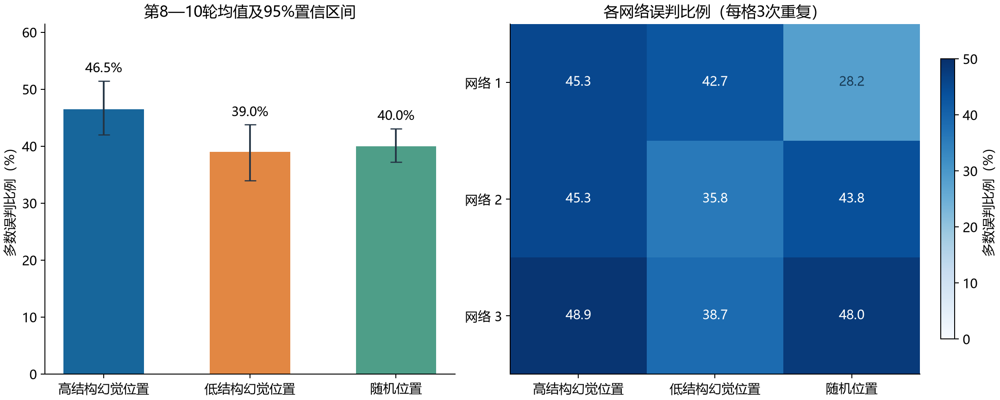
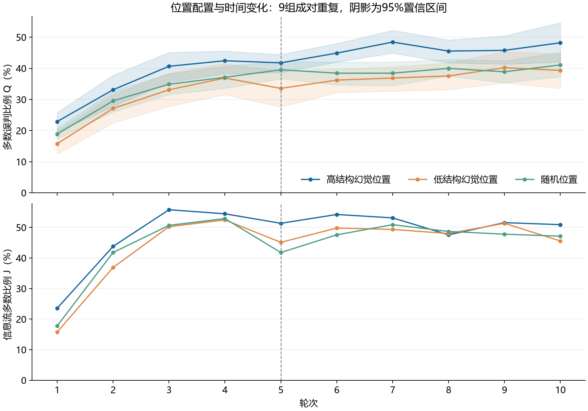

# 多数幻觉：初始化与连接位置实验记录

2026-11-16

后续位置初始化采用 **高结构幻觉位置（TH）**。其末3轮平均误判比例为 **46.5%**。
高、低位置的配对差为 **+7.5 个百分点**，95% CI [+2.4, +13.2]，Holm校正 p=0.1172。

单项检验 p=0.0391；三项比较校正后未达到0.05显著性标准。TH按最高误判均值选作后续工作点。

三张网络的高低位置差分别为+2.7、+9.6、+10.2个百分点，位置效果的网络差异见热图。

## 1. 文本库

双方各25条原创，每条2条赞同、2条反对评论，共50条原创、200条评论；由已配置DeepSeek生成，250条文本均通过数量、长度、重复与立场关系检查。

## 2. 初始化实验

N=100，50名观察者。先对96组参数做6轮随机搜索，再将8组候选延长并换3组网络/随机数复测；随后以真实DeepSeek验证基准、候选及相邻人数。完整搜索表见参数与初始化CSV。

| 真实验证条件 | 少数派占比 | ρ | 平均关注数 | 末3轮误判比例 |
|---|---:|---:|---:|---:|
| baseline | 16.0% | 3 | 8 | 10.7% |
| candidate62 | 16.0% | 6 | 12 | 12.7% |
| candidate7 | 16.0% | 3 | 4 | 13.3% |
| fraction20 | 20.0% | 6 | 12 | 34.7% |
| fraction24 | 24.0% | 6 | 12 | 52.7% |

## 3. 主实验初始化

| 参数 | 本次取值 | 依据 |
|---|---|---|
| N / 观察节点 | 1000 / 50 | 用户设定 |
| 少数派人数 k / 占比 | 200 / 20.0% | 初始化搜索 |
| 期望连接总数 / 平均关注数 | 12000 / 12 | 初始化搜索 |
| 轮次 / 主要汇总窗口 | 10 / 第8—10轮 | 5—10轮时间比较 |
| α / β | 0.05 / 10 | Banisch–Olbrich；Gaisbauer等 |
| ρ / κ / γ | 6 / 0.5 / 1 | 初始化搜索 |
| θ₀ / θh / θd / θhd | 1 / 0 / -1 / 0 | 初始化搜索 |
| s_out / s_in / w | 0.35 / 1.0 / 0.2 | 初始化搜索 |
| 基准发言概率 | Beta(0.24,0.85) | Román等的Beta-geometric参数转换 |
| 强度 / 社团规模 | 0.4、0.8各半 / 150、200、250、400 | 原模型量表；邻域复测 |
| 阅读窗口 / 条数 | 最近2轮 / 最多5条 | 邻域复测 |

数值含义：无反馈时，ρ=6可将个人基准发言概率0.2提升至0.6；仅考虑私人立场项时，κ=0.5使普通节点的同向评论概率约为60%—69%；已决定发言且有评论目标的观察者，在θ=[1,0,-1,0]下以50%—73%的概率选择评论，其余选择原创。

50名观察节点由DeepSeek更新感知并行动；其余节点依据私人立场和社会反馈行动，感知气候项关闭。私人立场保持固定。

## 4. 连接位置主实验

3张网络，每张3组独立个人参数/随机过程；每组比较高、低、随机位置，共27条10轮轨迹。配对控制社团名额、强度构成，粉丝总数、基准活跃度及ρ调整后的初始期望发言量差异均在5%以内。
三张图实际连接数为11998、12133、12018。9组配对的资源差异最大为4.64%。

| 位置 | 末3轮平均误判比例 | 95% CI |
|---|---:|---:|
| 高结构幻觉位置 | 46.5% | [42.0%, 51.5%] |
| 低结构幻觉位置 | 39.0% | [34.0%, 43.8%] |
| 随机位置 | 40.0% | [37.2%, 43.1%] |

| 配对比较 | 差异（百分点） | 95% CI | Holm p |
|---|---:|---:|---:|
| 高结构幻觉位置 − 低结构幻觉位置 | +7.5 | [+2.4, +13.2] | 0.1172 |
| 高结构幻觉位置 − 随机位置 | +6.5 | [+0.3, +12.8] | 0.3438 |
| 低结构幻觉位置 − 随机位置 | -1.0 | [-5.6, +4.4] | 0.8516 |

## 5. 延长时间的影响

同一轨迹比较第8—10轮与第3—5轮，正值表示后期误判增加。

| 位置 | 后期−前期（百分点） | 95% CI | Holm p |
|---|---:|---:|---:|
| 高结构幻觉位置 | +4.9 | [+2.0, +8.1] | 0.2227 |
| 低结构幻觉位置 | +4.5 | [+0.0, +9.1] | 0.2227 |
| 随机位置 | +2.8 | [+0.7, +5.0] | 0.2227 |

后期误判均值增加约2.8—4.9个百分点；三种配置的时间差异经校正均未达到显著性标准。

统计单位为完整运行，在三张固定网络内按完整配对组重采样10000次计算95% CI；显著性采用9组成对差异的精确符号翻转检验。位置比较和时间比较分别构成3项Holm校正检验。

## 参考依据

- [Banisch & Olbrich：反馈学习率α=0.05](https://www.tandfonline.com/doi/full/10.1080/0022250X.2018.1517761)
- [Gaisbauer等：反馈表达模型及β=10数值设定](https://journals.aps.org/pre/abstract/10.1103/PhysRevE.102.042303)
- [Román等：发帖概率分布参数](https://doi.org/10.3233/978-1-61499-105-2-756)
- [Bergstra & Bengio：随机超参数搜索](https://jmlr.org/papers/v13/bergstra12a.html)
