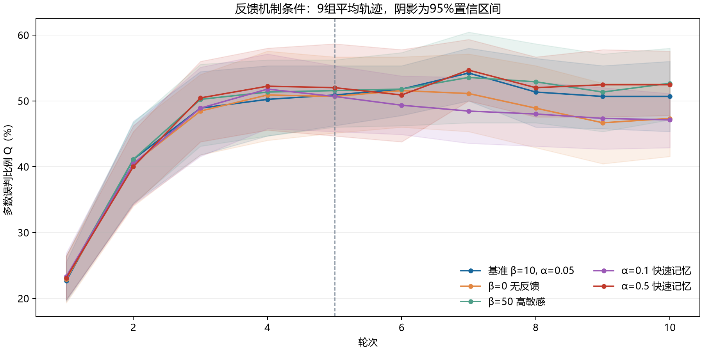

# 拓展二：反馈机制实验结果

2026-11-20

## 口径

配对单位与主实验一完全一致（同网络/个人参数/TH位置/组种子）；每条件9条10轮轨迹。
主要比较预先指定：FB1–FB4 各自对比 FB0，每个指标构成4项Holm校正检验；持续性（第8–10轮−第3–5轮）另成4项Holm检验。
FB0 基准用当前运行器与网关重跑（45条新轨迹）；2026-11-16归档的TH结果仅作描述性参考（当时为双网关双模型标识混合，见 summary.csv 的 _archived 列）。
无缺失轨迹；如有缺失会停止分析而不插补。

## 主要结果

| 指标 | 比较 | 差异（百分点） | 95% CI | p（Holm） |
|---|---|---:|---:|---:|
| 多数误判 Qill | β=0 无反馈 − 基准 β=10, α=0.05 | -3.3 | [-6.1, -0.4] | 0.1211（0.3633） |
| 多数误判 Qill | β=50 高敏感 − 基准 β=10, α=0.05 | +1.4 | [-0.6, +3.3] | 0.2930（0.4844） |
| 多数误判 Qill | α=0.1 快速记忆 − 基准 β=10, α=0.05 | -3.4 | [-5.7, -1.0] | 0.0703（0.2812） |
| 多数误判 Qill | α=0.5 快速记忆 − 基准 β=10, α=0.05 | +1.4 | [-0.0, +2.9] | 0.2422（0.4844） |
| 信息流多数 J | β=0 无反馈 − 基准 β=10, α=0.05 | -0.7 | [-4.1, +3.0] | 0.7695（1.0000） |
| 信息流多数 J | β=50 高敏感 − 基准 β=10, α=0.05 | +4.4 | [+1.5, +7.6] | 0.0391（0.1562） |
| 信息流多数 J | α=0.1 快速记忆 − 基准 β=10, α=0.05 | +3.0 | [-0.5, +6.7] | 0.2617（0.7852） |
| 信息流多数 J | α=0.5 快速记忆 − 基准 β=10, α=0.05 | -0.2 | [-4.1, +3.5] | 0.9453（1.0000） |
| 公开顺从 C | β=0 无反馈 − 基准 β=10, α=0.05 | -0.5 | [-1.2, +0.1] | 0.3125（0.3125） |
| 公开顺从 C | β=50 高敏感 − 基准 β=10, α=0.05 | -0.7 | [-1.1, -0.4] | 0.0156（0.0625） |
| 公开顺从 C | α=0.1 快速记忆 − 基准 β=10, α=0.05 | -1.0 | [-1.7, -0.4] | 0.0625（0.1875） |
| 公开顺从 C | α=0.5 快速记忆 − 基准 β=10, α=0.05 | -1.2 | [-1.9, -0.4] | 0.0820（0.1875） |
| 反对者沉默 S− | β=0 无反馈 − 基准 β=10, α=0.05 | -0.2 | [-0.5, +0.1] | 0.5000（1.0000） |
| 反对者沉默 S− | β=50 高敏感 − 基准 β=10, α=0.05 | +1.2 | [+0.5, +1.8] | 0.0312（0.1250） |
| 反对者沉默 S− | α=0.1 快速记忆 − 基准 β=10, α=0.05 | +0.4 | [-0.1, +1.0] | 0.4141（1.0000） |
| 反对者沉默 S− | α=0.5 快速记忆 − 基准 β=10, α=0.05 | +0.4 | [-0.1, +0.8] | 0.4844（1.0000） |

## 持续性（后期−前期 Qill）

| 比较 | 差异（百分点） | 95% CI | p（Holm） |
|---|---:|---:|---:|
| β=0 无反馈 − 基准 β=10, α=0.05 | -3.3 | [-6.9, +0.2] | 0.1875（0.5625） |
| β=50 高敏感 − 基准 β=10, α=0.05 | +0.4 | [-1.5, +2.3] | 0.7812（1.0000） |
| α=0.1 快速记忆 − 基准 β=10, α=0.05 | -3.9 | [-6.0, -1.5] | 0.0703（0.2812） |
| α=0.5 快速记忆 − 基准 β=10, α=0.05 | -0.1 | [-2.4, +2.4] | 0.9688（1.0000） |

