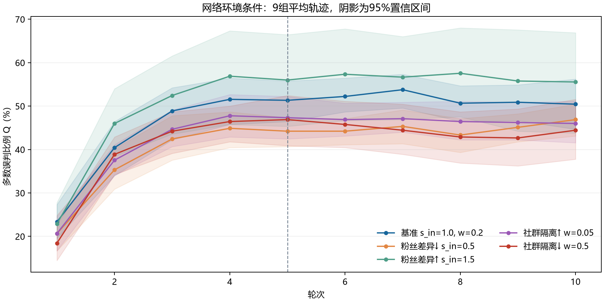
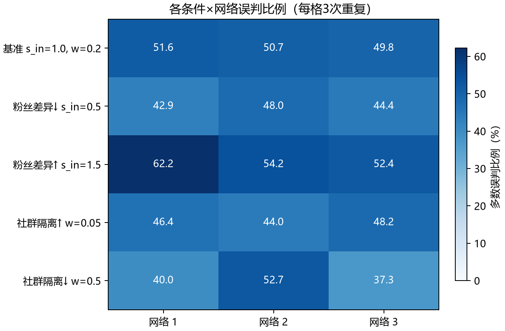

# 拓展三：网络环境实验结果

2026-11-20

## 口径

每条件9条10轮轨迹（3张网络×3组参数，TH位置）。网络条件之间网络不同，为非配对比较：
各条件独立图内分层 bootstrap 10000 次，差值分布双侧 p（零值平局不重复计数），每个指标4项Holm校正；
持续性（第8–10轮−第3–5轮）另成4项Holm检验。推断以 12 张生成网络为条件（4个新条件×3张网络）。
NW0 基准在主实验一的三张网络上用当前运行器与网关重跑；2026-11-16归档的TH结果仅作描述性参考。
无缺失轨迹；如有缺失会停止分析而不插补。

## 主要结果

| 指标 | 比较 | 差异（百分点） | 95% CI | p（Holm） |
|---|---|---:|---:|---:|
| 多数误判 Qill | 粉丝差异↓ s_in=0.5 − 基准 s_in=1.0, w=0.2 | -5.6 | [-11.0, -0.3] | 0.0361（0.1083） |
| 多数误判 Qill | 粉丝差异↑ s_in=1.5 − 基准 s_in=1.0, w=0.2 | +5.6 | [-5.6, +17.9] | 0.3580（0.3580） |
| 多数误判 Qill | 社群隔离↑ w=0.05 − 基准 s_in=1.0, w=0.2 | -4.4 | [-10.6, +1.7] | 0.1549（0.3098） |
| 多数误判 Qill | 社群隔离↓ w=0.5 − 基准 s_in=1.0, w=0.2 | -7.3 | [-13.4, -1.0] | 0.0199（0.0796） |
| 信息流多数 J | 粉丝差异↓ s_in=0.5 − 基准 s_in=1.0, w=0.2 | +0.9 | [-3.6, +5.5] | 0.7188（0.9915） |
| 信息流多数 J | 粉丝差异↑ s_in=1.5 − 基准 s_in=1.0, w=0.2 | +4.4 | [-0.8, +9.6] | 0.1000（0.4000） |
| 信息流多数 J | 社群隔离↑ w=0.05 − 基准 s_in=1.0, w=0.2 | -2.5 | [-7.3, +2.5] | 0.3305（0.9915） |
| 信息流多数 J | 社群隔离↓ w=0.5 − 基准 s_in=1.0, w=0.2 | -2.2 | [-7.6, +3.4] | 0.4428（0.9915） |
| 公开顺从 C | 粉丝差异↓ s_in=0.5 − 基准 s_in=1.0, w=0.2 | -0.4 | [-1.9, +1.0] | 0.6550（1.0000） |
| 公开顺从 C | 粉丝差异↑ s_in=1.5 − 基准 s_in=1.0, w=0.2 | +0.1 | [-1.3, +1.5] | 0.8076（1.0000） |
| 公开顺从 C | 社群隔离↑ w=0.05 − 基准 s_in=1.0, w=0.2 | +0.3 | [-1.3, +1.9] | 0.6987（1.0000） |
| 公开顺从 C | 社群隔离↓ w=0.5 − 基准 s_in=1.0, w=0.2 | -0.8 | [-2.2, +0.5] | 0.2803（1.0000） |
| 反对者沉默 S− | 粉丝差异↓ s_in=0.5 − 基准 s_in=1.0, w=0.2 | -0.3 | [-3.0, +2.1] | 0.8380（1.0000） |
| 反对者沉默 S− | 粉丝差异↑ s_in=1.5 − 基准 s_in=1.0, w=0.2 | -0.7 | [-4.3, +2.7] | 0.7258（1.0000） |
| 反对者沉默 S− | 社群隔离↑ w=0.05 − 基准 s_in=1.0, w=0.2 | +1.2 | [-2.2, +4.6] | 0.5205（1.0000） |
| 反对者沉默 S− | 社群隔离↓ w=0.5 − 基准 s_in=1.0, w=0.2 | +0.1 | [-3.4, +3.9] | 0.9619（1.0000） |

## 持续性（后期−前期 Qill）

| 比较 | 差异（百分点） | 95% CI | p（Holm） |
|---|---:|---:|---:|
| 粉丝差异↓ s_in=0.5 − 基准 s_in=1.0, w=0.2 | +1.2 | [-3.0, +5.2] | 0.5663（1.0000） |
| 粉丝差异↑ s_in=1.5 − 基准 s_in=1.0, w=0.2 | +1.1 | [-3.4, +5.8] | 0.6375（1.0000） |
| 社群隔离↑ w=0.05 − 基准 s_in=1.0, w=0.2 | -0.4 | [-3.4, +2.7] | 0.7694（1.0000） |
| 社群隔离↓ w=0.5 − 基准 s_in=1.0, w=0.2 | -2.6 | [-5.9, +0.9] | 0.1492（0.5968） |

## 范围（按社团的观察者 Qill，末3轮平均）

| 条件 | 社团1 | 社团2 | 社团3 | 社团4 |
|---|---:|---:|---:|---:|
| 基准 s_in=1.0, w=0.2 | 43.5% | 63.4% | 43.8% | 51.9% |
| 粉丝差异↓ s_in=0.5 | 47.2% | 39.5% | 54.0% | 41.6% |
| 粉丝差异↑ s_in=1.5 | 63.4% | 60.5% | 57.7% | 51.0% |
| 社群隔离↑ w=0.05 | 74.1% | 64.2% | 46.0% | 28.0% |
| 社群隔离↓ w=0.5 | 42.6% | 53.5% | 34.3% | 44.4% |

