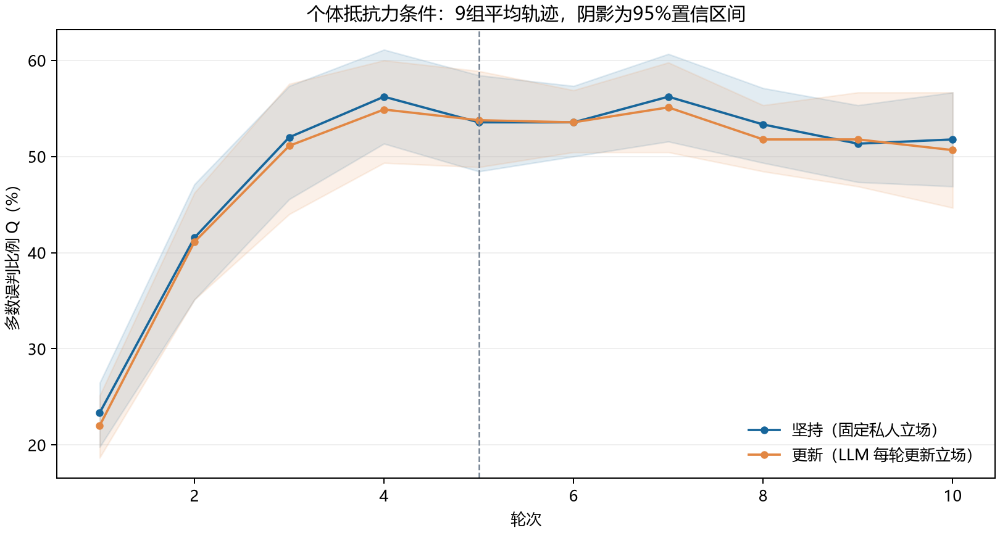

# 拓展一：个体抵抗力实验结果

2026-11-20

## 口径

两条件共用提示词 perception_attitude（v2，输出四字段）；R0 解析但不应用 new_stance，R1 应用。
只有观察者的私人立场允许更新（倡议者与其余950名普通节点立场始终固定），反对派占比上限 (200+50)/1000=25%，
Qill（反对者被误判为多数）的定义全程有效。新立场与下一轮消息一起提交，公开偏离按同一轮私人立场统计。
配对单位与主实验一完全一致；每个指标构成1项配对比较（符号翻转p=Holm p）。
无缺失轨迹；如有缺失会停止分析而不插补。

## 主要结果（R1 − R0）

| 指标 | 差异（百分点） | 95% CI | p（Holm） |
|---|---:|---:|---:|
| 多数误判 Qill | -0.7 | [-2.7, +0.8] | 0.8125（0.8125） |
| 信息流多数 J | +0.2 | [-0.7, +1.0] | 0.7812（0.7812） |
| 公开顺从 C | -0.1 | [-0.4, +0.1] | 0.5781（0.5781） |
| 反对者沉默 S− | +0.2 | [-0.1, +0.5] | 0.3594（0.3594） |

## 持续性（第8–10轮 − 第3–5轮 Qill，R1 − R0）

差异 -0.1 个百分点，95% CI [-1.9, +1.3]，p=1.0000（Holm 1.0000）。

## 私人转变 D 与真实支持率

| 条件 | 每轮平均转向反对 | 每轮平均转向支持 | 末轮反对派真实占比 |
|---|---:|---:|---:|
| 坚持（固定私人立场） | 0.00 | 0.00 | 20.0% |
| 更新（LLM 每轮更新立场） | 0.32 | 0.00 | 20.3% |

