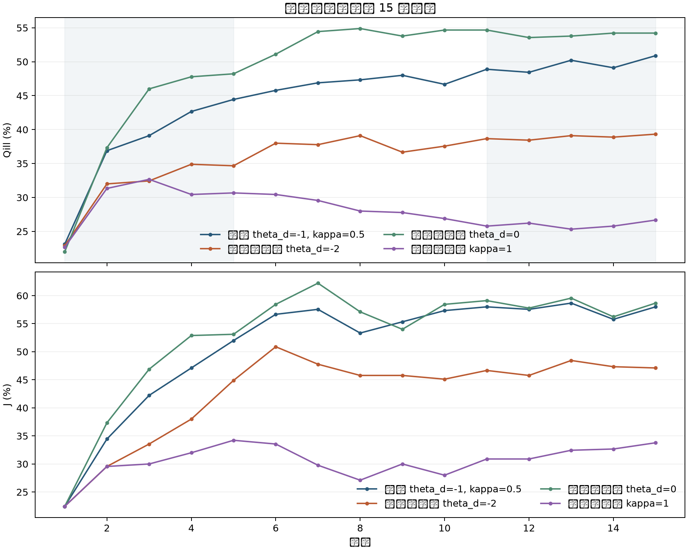

# 拓展一 v2：立场表达参数与 15 轮收敛

## 口径

不再比较私人立场是否更新。条件只改变 theta_d（感知逆风对评论概率的作用）或 kappa（私人立场对评论赞同方向的作用）。
共同使用 v2 根规则、read_limit=11、Beta(1,9) 多评论、15 轮、三张冻结网络、九个 TH 配对组。

## 收敛结果

| 条件 | Qill | J | C | S− | 后期−前期 Qill | 最后一步 Qill |
|---|---:|---:|---:|---:|---:|---:|
| 基准 theta_d=-1, kappa=0.5 | 49.51% | 57.60% | 4.22% | 78.93% | +12.27% | +1.78% |
| 高表达阻力 theta_d=-2 | 38.89% | 47.07% | 3.33% | 78.49% | +7.51% | +0.44% |
| 低表达阻力 theta_d=0 | 54.09% | 58.27% | 4.71% | 79.38% | +13.82% | +0.00% |
| 强立场一致 kappa=1 | 25.96% | 32.13% | 2.49% | 78.18% | -3.60% | +0.89% |

## 现实解释
theta_d 代表感到自己处于逆风时是否减少公开评论。kappa 代表私人立场对评论方向的坚持程度。早期、后期和最后一步变化分开报告，避免把单轮波动称为收敛。

## 故事化解释与续写

E1 的 $Q_{\\mathrm{ill}}$ 和 $J$ 同时下降约 10.6 个百分点，而 $C$ 只下降 0.89 个百分点，说明逆风并没有把人从网络里抹掉，更像是把他们从“评论别人”换到“直接发原创”。E2 的 $Q_{\\mathrm{ill}}$ 上升 4.58 个百分点，但 $J$ 只上升 0.67 个百分点，提示即时阅读与历史判断已经分叉：同一批作者的重复触达可能在有限窗口里累积成更强的 $\\hat p$。

E3 将 $\\kappa$ 提高到 1 后，$Q_{\\mathrm{ill}}$ 下降 23.56 个百分点、$J$ 下降 25.47 个百分点，后期还比前期低 3.60 个百分点。少数派的关键动作不是变得更响，而是拒绝把私人立场改写成随大流的评论。下一轮用 $\\theta_d\\times\\kappa$ 网格，并记录原创/评论数、独立作者数和重复触达，可区分“改变表达形式”和“改变表达方向”两条路径。

