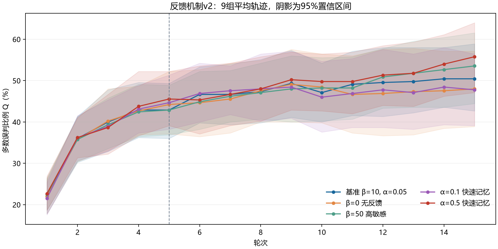

# 拓展二：反馈机制实验结果

2026-11-21

## 口径

配对单位与主实验一完全一致（同网络/个人参数/TH位置/组种子）；每条件9条15轮轨迹。
主要比较预先指定：FB1–FB4 各自对比 FB0，每个指标构成4项Holm校正检验；持续性（第8–10轮−第3–5轮）另成4项Holm检验。
FB0 基准用当前运行器与网关重跑（45条新轨迹）；2026-11-16归档的TH结果仅作描述性参考（当时为双网关双模型标识混合，见 summary.csv 的 _archived 列）。
无缺失轨迹；如有缺失会停止分析而不插补。

## 主要结果

| 指标 | 比较 | 差异（百分点） | 95% CI | p（Holm） |
|---|---|---:|---:|---:|
| 多数误判 Qill | β=0 无反馈 − 基准 β=10, α=0.05 | -2.6 | [-5.8, +0.4] | 0.2109（0.7188） |
| 多数误判 Qill | β=50 高敏感 − 基准 β=10, α=0.05 | +1.6 | [-3.1, +6.4] | 0.6289（0.7188） |
| 多数误判 Qill | α=0.1 快速记忆 − 基准 β=10, α=0.05 | -2.3 | [-4.9, +0.1] | 0.1797（0.7188） |
| 多数误判 Qill | α=0.5 快速记忆 − 基准 β=10, α=0.05 | +2.7 | [-0.8, +6.3] | 0.3125（0.7188） |
| 信息流多数 J | β=0 无反馈 − 基准 β=10, α=0.05 | -4.3 | [-9.6, +0.4] | 0.2500（1.0000） |
| 信息流多数 J | β=50 高敏感 − 基准 β=10, α=0.05 | +0.4 | [-3.7, +4.5] | 0.9023（1.0000） |
| 信息流多数 J | α=0.1 快速记忆 − 基准 β=10, α=0.05 | -1.8 | [-5.0, +1.4] | 0.3281（1.0000） |
| 信息流多数 J | α=0.5 快速记忆 − 基准 β=10, α=0.05 | +0.9 | [-1.2, +3.2] | 0.5312（1.0000） |
| 公开顺从 C | β=0 无反馈 − 基准 β=10, α=0.05 | -0.2 | [-0.8, +0.3] | 0.6094（1.0000） |
| 公开顺从 C | β=50 高敏感 − 基准 β=10, α=0.05 | -0.2 | [-1.2, +0.8] | 0.7656（1.0000） |
| 公开顺从 C | α=0.1 快速记忆 − 基准 β=10, α=0.05 | -0.1 | [-0.7, +0.4] | 0.8164（1.0000） |
| 公开顺从 C | α=0.5 快速记忆 − 基准 β=10, α=0.05 | -0.1 | [-0.5, +0.3] | 0.8125（1.0000） |
| 反对者沉默 S− | β=0 无反馈 − 基准 β=10, α=0.05 | +0.1 | [-0.4, +0.7] | 0.7852（1.0000） |
| 反对者沉默 S− | β=50 高敏感 − 基准 β=10, α=0.05 | +0.0 | [-1.2, +1.2] | 1.0000（1.0000） |
| 反对者沉默 S− | α=0.1 快速记忆 − 基准 β=10, α=0.05 | -0.4 | [-0.7, +0.0] | 0.1953（0.7812） |
| 反对者沉默 S− | α=0.5 快速记忆 − 基准 β=10, α=0.05 | -0.3 | [-0.8, +0.3] | 0.6016（1.0000） |

## 持续性（后期−前期 Qill）

| 比较 | 差异（百分点） | 95% CI | p（Holm） |
|---|---:|---:|---:|
| β=0 无反馈 − 基准 β=10, α=0.05 | -2.8 | [-6.1, +0.3] | 0.2109（0.6406） |
| β=50 高敏感 − 基准 β=10, α=0.05 | +1.7 | [-2.8, +6.6] | 0.5938（0.8281） |
| α=0.1 快速记忆 − 基准 β=10, α=0.05 | -2.4 | [-5.0, +0.2] | 0.1602（0.6406） |
| α=0.5 快速记忆 − 基准 β=10, α=0.05 | +2.0 | [-1.3, +5.6] | 0.4141（0.8281） |

## 收敛摘要

| 条件 | 早期 Qill | 后期 Qill | 后期−早期 | 最后一步 | 后五步平均绝对变化 |
|---|---:|---:|---:|---:|---:|
| 基准 β=10, α=0.05 | 36.76% | 49.87% | +13.11% | +0.00% | 0.33% |
| β=0 无反馈 | 36.98% | 47.29% | +10.31% | +0.44% | 0.33% |
| β=50 高敏感 | 36.58% | 51.42% | +14.84% | +0.89% | 1.33% |
| α=0.1 快速记忆 | 36.89% | 47.60% | +10.71% | -0.67% | 0.89% |
| α=0.5 快速记忆 | 37.38% | 52.53% | +15.16% | +1.78% | 1.50% |

## 故事化解释与续写

反馈像音量旋钮，而不是方向盘。$\\beta=0$、50 的后期 $Q_{\\mathrm{ill}}$ 分别为 47.29% 和 51.42%，$\\alpha=0.1$、0.5 分别为 47.60% 和 52.53%；这些差异尚未形成校正后的稳定处理效应，但轨迹步长已经从基准的 0.33 个百分点扩大到 $\\beta=50$ 的 1.33 和 $\\alpha=0.5$ 的 1.50。高敏感或快遗忘的节点更容易沿着上一轮回声摆动。

机制来自

$$
g_{i,t}=\\sigma\\left(\\log\\frac{g_{0i}}{1-g_{0i}}+\\beta F_{i,t}+a_i\\log\\rho\\right),\\qquad F_{i,t}=(1-\\alpha)F_{i,t-1}+\\alpha r_{i,t}.
$$

基准 $\\alpha=0.05$ 的半衰期约 13.5 轮，十五轮还没有真正忘掉早期反馈。下一轮应扫 $\\beta\\times\\alpha$，同时记录重复发言、反馈自相关和进入平台的轮数；若 $J$ 上升而 $Q_{\\mathrm{ill}}$ 不动，故事就是反馈制造曝光而没有制造人数判断。

