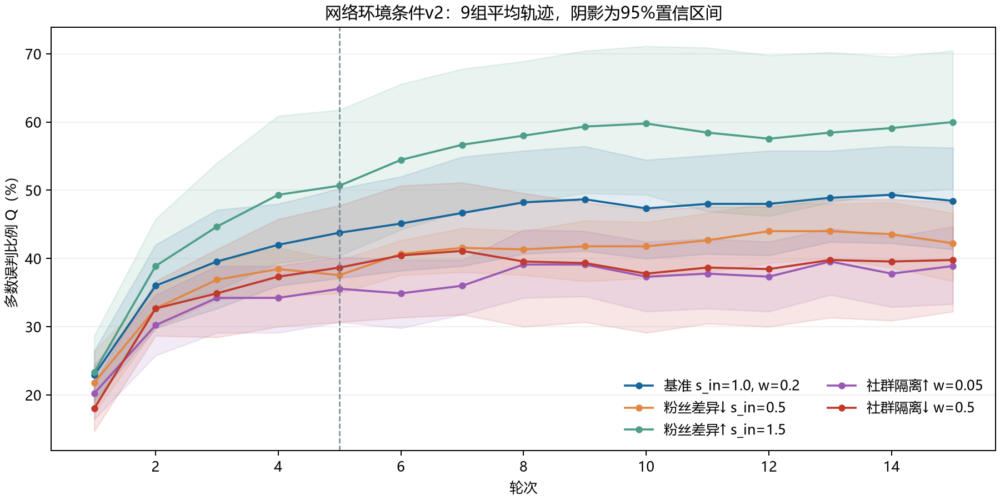
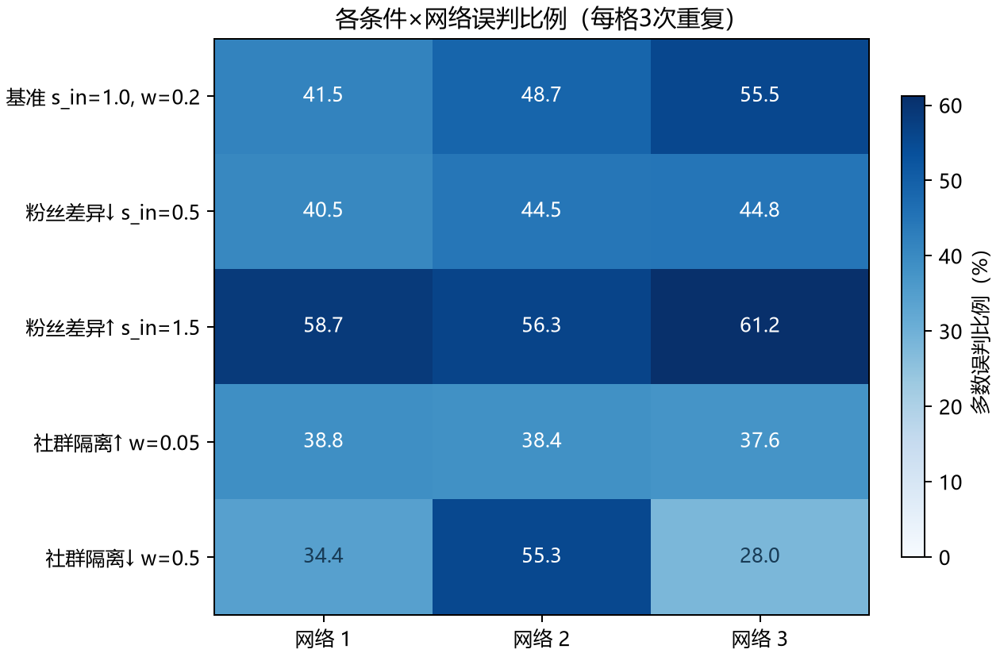

# 拓展三：网络环境实验结果

2026-11-20

## 口径

每条件9条15轮轨迹（3张网络×3组参数，TH位置）。网络条件之间网络不同，为非配对比较：
各条件独立图内分层 bootstrap 10000 次。表中的双侧量取未中心化差值分布的零点两尾比例（平局计一次），每个指标作4项Holm校正。
持续性（第11–15轮−第1–5轮）另作4项校正。结果以3张基准网络和12张新生成网络为条件，独立网络层的效应需另行检验。
NW0 基准在主实验一的三张网络上用当前运行器与网关重跑；2026-11-16归档的TH结果仅作描述性参考。
无缺失轨迹；如有缺失会停止分析而不插补。

## 主要结果

| 指标 | 比较 | 差异（百分点） | 95% CI | p（Holm） |
|---|---|---:|---:|---:|
| 多数误判 Qill | 粉丝差异↓ s_in=0.5 − 基准 s_in=1.0, w=0.2 | -5.2 | [-12.5, +2.0] | 0.1699（0.1920） |
| 多数误判 Qill | 粉丝差异↑ s_in=1.5 − 基准 s_in=1.0, w=0.2 | +10.2 | [-1.6, +22.1] | 0.0960（0.1920） |
| 多数误判 Qill | 社群隔离↑ w=0.05 − 基准 s_in=1.0, w=0.2 | -10.3 | [-18.2, -2.4] | 0.0097（0.0332） |
| 多数误判 Qill | 社群隔离↓ w=0.5 − 基准 s_in=1.0, w=0.2 | -9.3 | [-16.1, -2.3] | 0.0083（0.0332） |
| 信息流多数 J | 粉丝差异↓ s_in=0.5 − 基准 s_in=1.0, w=0.2 | -9.9 | [-13.6, -6.3] | 0.0000（0.0000） |
| 信息流多数 J | 粉丝差异↑ s_in=1.5 − 基准 s_in=1.0, w=0.2 | +4.2 | [-0.8, +10.0] | 0.1155（0.1155） |
| 信息流多数 J | 社群隔离↑ w=0.05 − 基准 s_in=1.0, w=0.2 | -8.0 | [-14.0, -2.2] | 0.0058（0.0116） |
| 信息流多数 J | 社群隔离↓ w=0.5 − 基准 s_in=1.0, w=0.2 | -9.1 | [-14.1, -4.4] | 0.0000（0.0000） |
| 公开顺从 C | 粉丝差异↓ s_in=0.5 − 基准 s_in=1.0, w=0.2 | -0.2 | [-1.1, +0.7] | 0.6272（1.0000） |
| 公开顺从 C | 粉丝差异↑ s_in=1.5 − 基准 s_in=1.0, w=0.2 | +0.2 | [-1.0, +1.5] | 0.7359（1.0000） |
| 公开顺从 C | 社群隔离↑ w=0.05 − 基准 s_in=1.0, w=0.2 | +0.8 | [-0.3, +2.0] | 0.1499（0.4497） |
| 公开顺从 C | 社群隔离↓ w=0.5 − 基准 s_in=1.0, w=0.2 | +1.0 | [-0.0, +2.0] | 0.0617（0.2468） |
| 反对者沉默 S− | 粉丝差异↓ s_in=0.5 − 基准 s_in=1.0, w=0.2 | -0.5 | [-3.6, +2.0] | 0.7409（1.0000） |
| 反对者沉默 S− | 粉丝差异↑ s_in=1.5 − 基准 s_in=1.0, w=0.2 | -0.7 | [-4.2, +2.7] | 0.7156（1.0000） |
| 反对者沉默 S− | 社群隔离↑ w=0.05 − 基准 s_in=1.0, w=0.2 | -0.8 | [-4.8, +2.8] | 0.6735（1.0000） |
| 反对者沉默 S− | 社群隔离↓ w=0.5 − 基准 s_in=1.0, w=0.2 | -1.1 | [-5.0, +2.4] | 0.5909（1.0000） |

## 持续性（后期−前期 Qill）

| 比较 | 差异（百分点） | 95% CI | p（Holm） |
|---|---:|---:|---:|
| 粉丝差异↓ s_in=0.5 − 基准 s_in=1.0, w=0.2 | -1.9 | [-6.0, +2.3] | 0.3947（0.3947） |
| 粉丝差异↑ s_in=1.5 − 基准 s_in=1.0, w=0.2 | +5.6 | [+0.8, +10.4] | 0.0186（0.0558） |
| 社群隔离↑ w=0.05 − 基准 s_in=1.0, w=0.2 | -4.3 | [-8.8, -0.1] | 0.0431（0.0862） |
| 社群隔离↓ w=0.5 − 基准 s_in=1.0, w=0.2 | -4.8 | [-8.6, -1.1] | 0.0110（0.0440） |

## 收敛摘要

| 条件 | 早期 Qill | 后期 Qill | 后期−早期 | 最后一步 | 后五步平均绝对变化 |
|---|---:|---:|---:|---:|---:|
| 基准 s_in=1.0, w=0.2 | 36.84% | 48.53% | +11.69% | -0.89% | 0.56% |
| 粉丝差异↓ s_in=0.5 | 33.47% | 43.29% | +9.82% | -1.33% | 0.78% |
| 粉丝差异↑ s_in=1.5 | 41.38% | 58.71% | +17.33% | +0.89% | 0.83% |
| 社群隔离↑ w=0.05 | 30.89% | 38.27% | +7.38% | +1.11% | 1.39% |
| 社群隔离↓ w=0.5 | 32.31% | 39.24% | +6.93% | +0.22% | 0.50% |

## 范围（按社团的观察者 Qill，末3轮平均）

| 条件 | 社团1 | 社团2 | 社团3 | 社团4 |
|---|---:|---:|---:|---:|
| 基准 s_in=1.0, w=0.2 | 47.2% | 54.3% | 51.2% | 43.9% |
| 粉丝差异↓ s_in=0.5 | 46.8% | 39.1% | 52.5% | 34.6% |
| 粉丝差异↑ s_in=1.5 | 67.1% | 59.3% | 65.4% | 52.2% |
| 社群隔离↑ w=0.05 | 66.2% | 71.2% | 48.1% | 8.5% |
| 社群隔离↓ w=0.5 | 45.4% | 42.4% | 33.3% | 38.1% |

