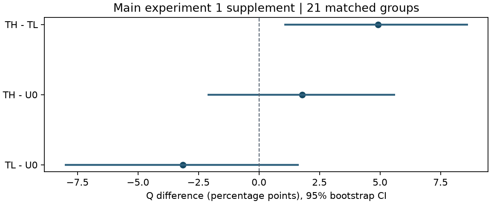

# 主实验一补充验证

63 条十轮完整轨迹通过独立审计。Q 和 J 取第 8–10 轮均值。

| 网络 | 参数组 | 位置 | Q | J |
|---:|---:|---|---:|---:|
| 1 | 4 | TH | 25.33% | 46.67% |
| 1 | 4 | TL | 31.33% | 42.67% |
| 1 | 4 | U0 | 40.00% | 59.33% |
| 1 | 5 | TL | 57.33% | 50.67% |
| 1 | 5 | U0 | 42.00% | 40.67% |
| 1 | 5 | TH | 53.33% | 46.67% |
| 1 | 6 | U0 | 36.00% | 38.67% |
| 1 | 6 | TH | 48.67% | 41.33% |
| 1 | 6 | TL | 46.67% | 41.33% |
| 1 | 7 | TH | 42.00% | 56.67% |
| 1 | 7 | TL | 48.67% | 51.33% |
| 1 | 7 | U0 | 45.33% | 52.67% |
| 1 | 8 | TL | 33.33% | 51.33% |
| 1 | 8 | U0 | 57.33% | 46.67% |
| 1 | 8 | TH | 43.33% | 42.67% |
| 1 | 9 | U0 | 40.00% | 42.67% |
| 1 | 9 | TH | 34.00% | 50.00% |
| 1 | 9 | TL | 57.33% | 51.33% |
| 1 | 10 | TH | 42.00% | 46.67% |
| 1 | 10 | TL | 29.33% | 34.00% |
| 1 | 10 | U0 | 54.00% | 45.33% |
| 2 | 4 | TH | 47.33% | 56.67% |
| 2 | 4 | TL | 22.67% | 45.33% |
| 2 | 4 | U0 | 37.33% | 54.00% |
| 2 | 5 | TL | 46.00% | 52.67% |
| 2 | 5 | U0 | 58.00% | 53.33% |
| 2 | 5 | TH | 48.67% | 64.00% |
| 2 | 6 | U0 | 42.00% | 44.67% |
| 2 | 6 | TH | 53.33% | 41.33% |
| 2 | 6 | TL | 42.00% | 39.33% |
| 2 | 7 | TH | 53.33% | 53.33% |
| 2 | 7 | TL | 42.00% | 46.00% |
| 2 | 7 | U0 | 52.00% | 44.00% |
| 2 | 8 | TL | 44.00% | 44.00% |
| 2 | 8 | U0 | 34.67% | 44.67% |
| 2 | 8 | TH | 34.00% | 42.00% |
| 2 | 9 | U0 | 37.33% | 44.00% |
| 2 | 9 | TH | 42.67% | 50.00% |
| 2 | 9 | TL | 33.33% | 42.00% |
| 2 | 10 | TH | 42.00% | 53.33% |
| 2 | 10 | TL | 37.33% | 52.67% |
| 2 | 10 | U0 | 33.33% | 54.00% |
| 3 | 4 | TH | 52.67% | 54.00% |
| 3 | 4 | TL | 42.67% | 47.33% |
| 3 | 4 | U0 | 50.00% | 48.67% |
| 3 | 5 | TL | 47.33% | 53.33% |
| 3 | 5 | U0 | 48.00% | 48.00% |
| 3 | 5 | TH | 57.33% | 43.33% |
| 3 | 6 | U0 | 44.00% | 34.67% |
| 3 | 6 | TH | 50.67% | 49.33% |
| 3 | 6 | TL | 42.67% | 43.33% |
| 3 | 7 | TH | 64.00% | 58.67% |
| 3 | 7 | TL | 44.67% | 50.00% |
| 3 | 7 | U0 | 49.33% | 56.67% |
| 3 | 8 | TL | 46.67% | 46.00% |
| 3 | 8 | U0 | 38.00% | 40.00% |
| 3 | 8 | TH | 52.67% | 51.33% |
| 3 | 9 | U0 | 51.33% | 52.67% |
| 3 | 9 | TH | 55.33% | 53.33% |
| 3 | 9 | TL | 47.33% | 48.00% |
| 3 | 10 | TH | 40.67% | 50.67% |
| 3 | 10 | TL | 37.33% | 43.33% |
| 3 | 10 | U0 | 56.00% | 49.33% |

## 新增配对组的预定比较

| 比较 | 差（百分点） | 95% 区间 | Holm p |
|---|---:|---:|---:|
| TH − TL | +4.92 | [+1.05, +8.63] | 0.1441 |
| TH − U0 | +1.78 | [-2.13, +5.62] | 0.4844 |
| TL − U0 | -3.14 | [-8.03, +1.65] | 0.4844 |

配对单位为新增的 21 组，条件限定在原来的三张网络。历史组和合并结果作描述性参照，详见 audit.json。

## 为什么相同的少数派人数会有不同的可见度

把同样 200 位倡议者放到不同位置时，决定旁观者印象的是他们关注谁、那些人是否发言，以及读者最终抽到了哪些消息。高幻觉位置比低幻觉位置的 Q 平均高 4.92 个百分点，21 组中 16 组为正。但三张图的差分别为 −2.19、+7.71、+9.24 个百分点，第一张图出现反向。高幻觉位置相对随机位置只高 1.78 个百分点，区间包含零。当前结果支持展示位置可能改变局部印象，多重比较校正后仍需谨慎解释。

主实验一历史批次的 TH−TL 为 +7.48 个百分点。新增批次方向相同，幅度更小，且复用了原三张网络。这增加了固定网络内的重复证据，拓扑普适性仍需新增独立网络。旧批次存在多路模型标识，合并均值仅作描述。 [多数幻觉的网络结构解释](https://doi.org/10.1371/journal.pone.0147617)

## 已知调用用量

实际请求 30,637 次，已知输入 95,290,394 Token，已知输出 2,584,622 Token。用量缺失情况见 audit.json。
