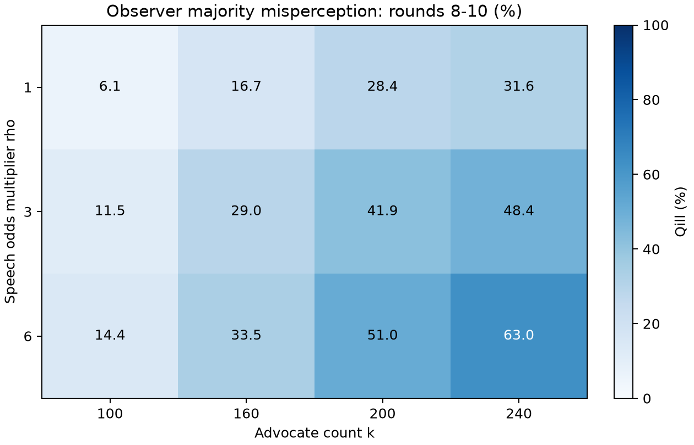
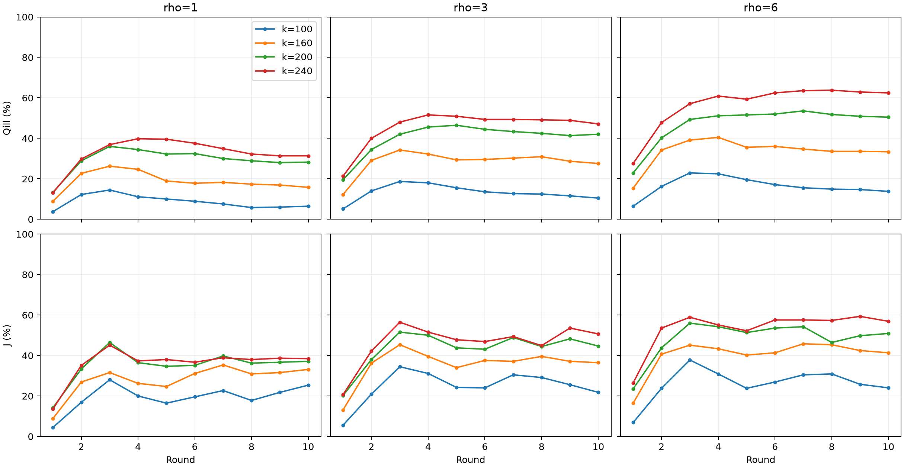

# 主实验二结果

完整轨迹：108。私人立场固定，仅50名观察者使用LLM。

| 条件 | 图/组 | 末3轮Qill | 末3轮J | 初始IG |
| --- | --- | ---: | ---: | ---: |
| k=100, rho=1 | g0-r0 | 0.67% | 24.00% | 3.56% |
| k=100, rho=3 | g0-r0 | 8.67% | 25.33% | 3.56% |
| k=100, rho=6 | g0-r0 | 5.33% | 24.67% | 3.56% |
| k=160, rho=1 | g0-r0 | 21.33% | 48.67% | 7.14% |
| k=160, rho=3 | g0-r0 | 45.33% | 45.33% | 7.14% |
| k=160, rho=6 | g0-r0 | 48.00% | 51.33% | 7.14% |
| k=200, rho=1 | g0-r0 | 22.00% | 38.00% | 10.50% |
| k=200, rho=3 | g0-r0 | 30.00% | 40.00% | 10.50% |
| k=200, rho=6 | g0-r0 | 49.33% | 54.00% | 10.50% |
| k=240, rho=1 | g0-r0 | 47.33% | 43.33% | 16.05% |
| k=240, rho=3 | g0-r0 | 53.33% | 49.33% | 16.05% |
| k=240, rho=6 | g0-r0 | 64.67% | 64.00% | 16.05% |
| k=100, rho=3 | g0-r1 | 5.33% | 26.00% | 3.00% |
| k=100, rho=6 | g0-r1 | 9.33% | 30.67% | 3.00% |
| k=160, rho=1 | g0-r1 | 8.00% | 23.33% | 8.45% |
| k=160, rho=3 | g0-r1 | 16.67% | 29.33% | 8.45% |
| k=160, rho=6 | g0-r1 | 25.33% | 34.67% | 8.45% |
| k=200, rho=1 | g0-r1 | 38.00% | 44.67% | 11.50% |
| k=200, rho=3 | g0-r1 | 49.33% | 52.00% | 11.50% |
| k=200, rho=6 | g0-r1 | 60.67% | 58.67% | 11.50% |
| k=240, rho=1 | g0-r1 | 28.67% | 38.67% | 14.61% |
| k=240, rho=3 | g0-r1 | 41.33% | 50.00% | 14.61% |
| k=240, rho=6 | g0-r1 | 54.67% | 54.67% | 14.61% |
| k=100, rho=1 | g0-r1 | 3.33% | 26.00% | 3.00% |
| k=100, rho=6 | g0-r2 | 25.33% | 34.00% | 3.56% |
| k=160, rho=1 | g0-r2 | 10.67% | 30.00% | 8.10% |
| k=160, rho=3 | g0-r2 | 21.33% | 28.00% | 8.10% |
| k=160, rho=6 | g0-r2 | 34.67% | 42.67% | 8.10% |
| k=200, rho=1 | g0-r2 | 32.00% | 40.00% | 11.38% |
| k=200, rho=3 | g0-r2 | 33.33% | 52.00% | 11.38% |
| k=200, rho=6 | g0-r2 | 48.67% | 48.00% | 11.38% |
| k=240, rho=1 | g0-r2 | 35.33% | 32.67% | 17.24% |
| k=240, rho=3 | g0-r2 | 50.67% | 57.33% | 17.24% |
| k=240, rho=6 | g0-r2 | 60.00% | 58.67% | 17.24% |
| k=100, rho=1 | g0-r2 | 8.00% | 24.67% | 3.56% |
| k=100, rho=3 | g0-r2 | 22.00% | 31.33% | 3.56% |
| k=160, rho=1 | g1-r0 | 27.33% | 36.00% | 9.76% |
| k=160, rho=3 | g1-r0 | 44.00% | 42.67% | 9.76% |
| k=160, rho=6 | g1-r0 | 40.67% | 50.67% | 9.76% |
| k=200, rho=1 | g1-r0 | 14.00% | 28.67% | 10.50% |
| k=200, rho=3 | g1-r0 | 34.67% | 30.67% | 10.50% |
| k=200, rho=6 | g1-r0 | 44.67% | 36.00% | 10.50% |
| k=240, rho=1 | g1-r0 | 32.00% | 41.33% | 15.13% |
| k=240, rho=3 | g1-r0 | 43.33% | 52.00% | 15.13% |
| k=240, rho=6 | g1-r0 | 60.00% | 60.00% | 15.13% |
| k=100, rho=1 | g1-r0 | 3.33% | 22.00% | 2.56% |
| k=100, rho=3 | g1-r0 | 4.67% | 28.00% | 2.56% |
| k=100, rho=6 | g1-r0 | 8.00% | 24.67% | 2.56% |
| k=160, rho=3 | g1-r1 | 18.00% | 34.00% | 7.38% |
| k=160, rho=6 | g1-r1 | 17.33% | 40.67% | 7.38% |
| k=200, rho=1 | g1-r1 | 22.00% | 34.67% | 11.00% |
| k=200, rho=3 | g1-r1 | 42.00% | 39.33% | 11.00% |
| k=200, rho=6 | g1-r1 | 45.33% | 50.67% | 11.00% |
| k=240, rho=1 | g1-r1 | 18.00% | 33.33% | 18.03% |
| k=240, rho=3 | g1-r1 | 38.67% | 40.67% | 18.03% |
| k=240, rho=6 | g1-r1 | 55.33% | 44.67% | 18.03% |
| k=100, rho=1 | g1-r1 | 3.33% | 14.00% | 4.00% |
| k=100, rho=3 | g1-r1 | 9.33% | 26.67% | 4.00% |
| k=100, rho=6 | g1-r1 | 8.67% | 23.33% | 4.00% |
| k=160, rho=1 | g1-r1 | 4.67% | 24.67% | 7.38% |
| k=160, rho=6 | g1-r2 | 48.67% | 43.33% | 9.40% |
| k=200, rho=1 | g1-r2 | 28.00% | 30.67% | 12.75% |
| k=200, rho=3 | g1-r2 | 49.33% | 47.33% | 12.75% |
| k=200, rho=6 | g1-r2 | 61.33% | 52.00% | 12.75% |
| k=240, rho=1 | g1-r2 | 36.67% | 37.33% | 19.21% |
| k=240, rho=3 | g1-r2 | 58.00% | 50.00% | 19.21% |
| k=240, rho=6 | g1-r2 | 74.67% | 60.00% | 19.21% |
| k=100, rho=1 | g1-r2 | 10.00% | 22.67% | 5.22% |
| k=100, rho=3 | g1-r2 | 17.33% | 28.67% | 5.22% |
| k=100, rho=6 | g1-r2 | 30.00% | 30.67% | 5.22% |
| k=160, rho=1 | g1-r2 | 20.00% | 34.00% | 9.40% |
| k=160, rho=3 | g1-r2 | 40.67% | 37.33% | 9.40% |
| k=200, rho=1 | g2-r0 | 46.00% | 41.33% | 14.88% |
| k=200, rho=3 | g2-r0 | 53.33% | 50.00% | 14.88% |
| k=200, rho=6 | g2-r0 | 56.67% | 46.67% | 14.88% |
| k=240, rho=1 | g2-r0 | 32.00% | 37.33% | 16.97% |
| k=240, rho=3 | g2-r0 | 48.00% | 41.33% | 16.97% |
| k=240, rho=6 | g2-r0 | 68.67% | 53.33% | 16.97% |
| k=100, rho=1 | g2-r0 | 14.00% | 24.00% | 3.22% |
| k=100, rho=3 | g2-r0 | 15.33% | 21.33% | 3.22% |
| k=100, rho=6 | g2-r0 | 18.00% | 28.00% | 3.22% |
| k=160, rho=1 | g2-r0 | 14.67% | 26.00% | 5.71% |
| k=160, rho=3 | g2-r0 | 18.00% | 32.67% | 5.71% |
| k=160, rho=6 | g2-r0 | 23.33% | 34.67% | 5.71% |
| k=200, rho=3 | g2-r1 | 39.33% | 46.00% | 11.62% |
| k=200, rho=6 | g2-r1 | 39.33% | 38.67% | 11.62% |
| k=240, rho=1 | g2-r1 | 21.33% | 37.33% | 15.39% |
| k=240, rho=3 | g2-r1 | 52.00% | 50.00% | 15.39% |
| k=240, rho=6 | g2-r1 | 64.67% | 58.67% | 15.39% |
| k=100, rho=1 | g2-r1 | 6.00% | 21.33% | 3.00% |
| k=100, rho=3 | g2-r1 | 10.67% | 20.00% | 3.00% |
| k=100, rho=6 | g2-r1 | 13.33% | 24.00% | 3.00% |
| k=160, rho=1 | g2-r1 | 26.00% | 30.00% | 9.05% |
| k=160, rho=3 | g2-r1 | 26.67% | 44.00% | 9.05% |
| k=160, rho=6 | g2-r1 | 31.33% | 41.33% | 9.05% |
| k=200, rho=1 | g2-r1 | 20.00% | 34.00% | 11.62% |
| k=200, rho=6 | g2-r2 | 53.33% | 56.67% | 13.00% |
| k=240, rho=1 | g2-r2 | 33.33% | 44.00% | 18.03% |
| k=240, rho=3 | g2-r2 | 50.00% | 56.67% | 18.03% |
| k=240, rho=6 | g2-r2 | 64.67% | 66.67% | 18.03% |
| k=100, rho=1 | g2-r2 | 6.00% | 16.00% | 2.78% |
| k=100, rho=3 | g2-r2 | 10.00% | 22.00% | 2.78% |
| k=100, rho=6 | g2-r2 | 12.00% | 22.00% | 2.78% |
| k=160, rho=1 | g2-r2 | 17.33% | 34.00% | 9.88% |
| k=160, rho=3 | g2-r2 | 30.67% | 46.00% | 9.88% |
| k=160, rho=6 | g2-r2 | 32.00% | 48.00% | 9.88% |
| k=200, rho=1 | g2-r2 | 33.33% | 38.00% | 13.00% |
| k=200, rho=3 | g2-r2 | 46.00% | 54.67% | 13.00% |

## 预定主要比较

| 比较 | 差值（百分点） | 区间（百分点） | 原始p | Holm p |
| --- | ---: | --- | ---: | ---: |
| count_endpoints | +37.01 | [+33.53, +40.77] | 0.0039 | 0.0117 |
| activity_endpoints | +19.81 | [+18.09, +21.96] | 0.0039 | 0.0117 |
| interaction_endpoints | +23.04 | [+19.70, +26.44] | 0.0039 | 0.0117 |





区间为逐项bootstrap区间；三项主要检验使用Holm校正。显著性不由区间单独判定。
未达覆盖目标的条件记录为未达标；最小人数仅限本次已测网格，不外推为普适阈值。

## ????

????????????????????????????????????????????? 10% ????rho=1 ??????? 24% ??? rho=6 ????? Qill ?? 6.1% ???? 63.0%??? 56.9 ???????????????????? +37.0 ??????????????? +19.8 ????????? +23.0 ??????? Holm ???? p ?? 0.0117?????????????

?????????????????????????? 10% ????? Qill ? 6.1% ?? 14.4%?? 24% ?????? 31.6% ?? 63.0%???????????????????????????????????????????? Qill?80% ???????? 80% ???????????

???????????????????????????????????????????????????????????????????????????????????????????????? TH ????????????????????????

## 调用用量

```json
{
  "actual_calls": 52108,
  "reused_rows": 2510,
  "ok": 51994,
  "api_error": 4,
  "invalid_response": 110,
  "other_status": 0,
  "known_input_tokens": 159229770,
  "known_output_tokens": 4363721,
  "calls_without_complete_usage": 4
}
```

已排除缓存复用行；缺失usage没有按实际零消耗解释，已知token不等于供应商最终账单。
历史反馈和非观测节点规则沿用主实验一；结果仅针对固定网络与当前TH构造策略。
