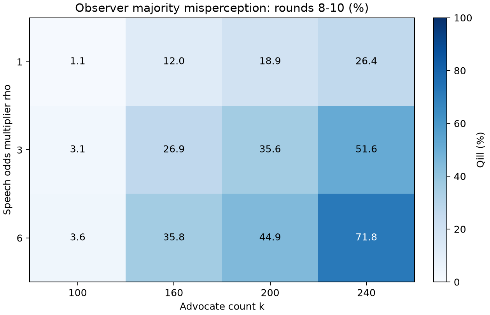
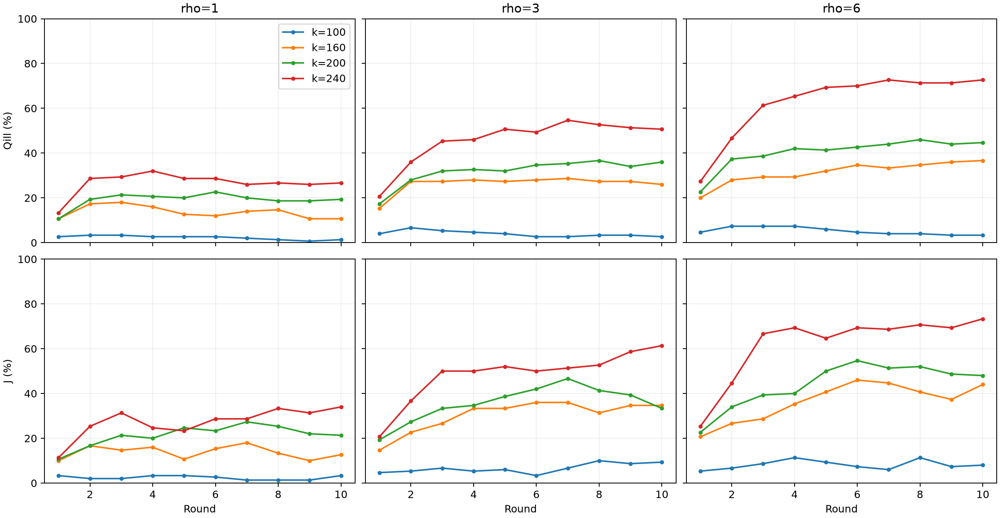
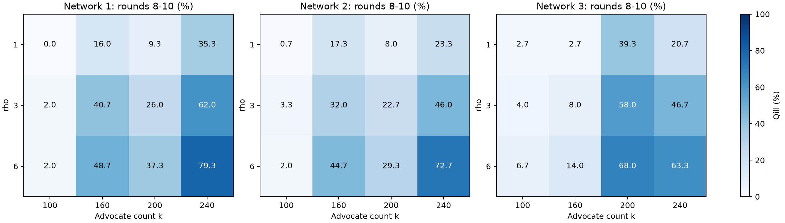
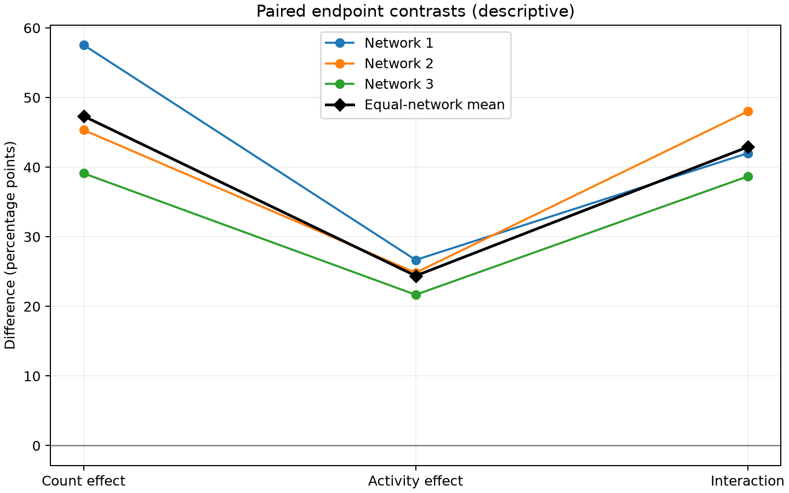

# 主实验二结果

完整轨迹：36。私人立场固定，仅50名观察者使用LLM。

| 条件 | 图/组 | 末3轮Qill | 末3轮J | 初始IG |
| --- | --- | ---: | ---: | ---: |
| k=100, rho=1 | g0-r0 | 0.00% | 0.00% | 3.56% |
| k=100, rho=3 | g0-r0 | 2.00% | 3.33% | 3.56% |
| k=100, rho=6 | g0-r0 | 2.00% | 4.67% | 3.56% |
| k=160, rho=1 | g0-r0 | 16.00% | 12.67% | 7.14% |
| k=160, rho=3 | g0-r0 | 40.67% | 36.67% | 7.14% |
| k=160, rho=6 | g0-r0 | 48.67% | 52.00% | 7.14% |
| k=200, rho=1 | g0-r0 | 9.33% | 8.00% | 10.50% |
| k=200, rho=3 | g0-r0 | 26.00% | 32.00% | 10.50% |
| k=200, rho=6 | g0-r0 | 37.33% | 40.67% | 10.50% |
| k=240, rho=1 | g0-r0 | 35.33% | 36.67% | 16.05% |
| k=240, rho=3 | g0-r0 | 62.00% | 67.33% | 16.05% |
| k=240, rho=6 | g0-r0 | 79.33% | 74.00% | 16.05% |
| k=100, rho=3 | g1-r0 | 3.33% | 16.00% | 2.56% |
| k=100, rho=6 | g1-r0 | 2.00% | 12.67% | 2.56% |
| k=160, rho=1 | g1-r0 | 17.33% | 18.00% | 9.76% |
| k=160, rho=3 | g1-r0 | 32.00% | 47.33% | 9.76% |
| k=160, rho=6 | g1-r0 | 44.67% | 52.00% | 9.76% |
| k=200, rho=1 | g1-r0 | 8.00% | 19.33% | 10.50% |
| k=200, rho=3 | g1-r0 | 22.67% | 30.67% | 10.50% |
| k=200, rho=6 | g1-r0 | 29.33% | 46.00% | 10.50% |
| k=240, rho=1 | g1-r0 | 23.33% | 40.00% | 15.13% |
| k=240, rho=3 | g1-r0 | 46.00% | 60.67% | 15.13% |
| k=240, rho=6 | g1-r0 | 72.67% | 74.00% | 15.13% |
| k=100, rho=1 | g1-r0 | 0.67% | 3.33% | 2.56% |
| k=100, rho=6 | g2-r0 | 6.67% | 9.33% | 3.22% |
| k=160, rho=1 | g2-r0 | 2.67% | 5.33% | 5.71% |
| k=160, rho=3 | g2-r0 | 8.00% | 16.67% | 5.71% |
| k=160, rho=6 | g2-r0 | 14.00% | 18.00% | 5.71% |
| k=200, rho=1 | g2-r0 | 39.33% | 41.33% | 14.88% |
| k=200, rho=3 | g2-r0 | 58.00% | 51.33% | 14.88% |
| k=200, rho=6 | g2-r0 | 68.00% | 62.00% | 14.88% |
| k=240, rho=1 | g2-r0 | 20.67% | 22.00% | 16.97% |
| k=240, rho=3 | g2-r0 | 46.67% | 44.67% | 16.97% |
| k=240, rho=6 | g2-r0 | 63.33% | 65.33% | 16.97% |
| k=100, rho=1 | g2-r0 | 2.67% | 2.67% | 3.22% |
| k=100, rho=3 | g2-r0 | 4.00% | 8.67% | 3.22% |

## 预定主要比较（描述性）

| 比较 | 平均差值（百分点） | 网络1 | 网络2 | 网络3 |
| --- | ---: | ---: | ---: | ---: |
| count_endpoints | +47.33 | +57.56 | +45.33 | +39.11 |
| activity_endpoints | +24.39 | +26.67 | +24.83 | +21.67 |
| interaction_endpoints | +42.89 | +42.00 | +48.00 | +38.67 |

仅3张固定网络、各1组个体配置；展示配对差异和网络间一致性，不计算退化的图内bootstrap区间，不作显著性结论。
人数效应：k=240减k=100，跨rho平均；积极性效应：rho=6减rho=1，跨k平均；交互：两端人数差在rho=6与rho=1之间的差。









未达覆盖目标的条件记录为未达标；最小人数仅限本次已测网格，不外推为普适阈值。

## 调用用量

```json
{
  "actual_calls": 17977,
  "reused_rows": 648,
  "ok": 17312,
  "api_error": 544,
  "invalid_response": 121,
  "other_status": 0,
  "known_input_tokens": 84654701,
  "known_output_tokens": 1463976,
  "calls_without_complete_usage": 544
}
```

已排除缓存复用行；缺失usage没有按实际零消耗解释，已知token不等于供应商最终账单。
结果仅针对本次冻结配置、固定网络与继承的TH位置。新版为本地感知、统一11条阅读及Beta-Binomial多评论；历史结果保持原协议。

## 接口切换记录

本批实验经用户授权从DeepSeek直连接口切换至1nvictus网关继续执行。用户确认底层模型相同；响应模型别名不能独立验证等价性。原始完成结果未重写，未完成运行复用既有成功请求。具体切换任务、调用日志字节边界与实际配置见[gateway-transition-20261125T043842905000Z.json](../gateway-transition-20261125T043842905000Z.json)、[gateway-transition-20261125T081140755993Z.json](../gateway-transition-20261125T081140755993Z.json)、[gateway-transition-20261125T111505059895Z.json](../gateway-transition-20261125T111505059895Z.json)。

续跑已显式加入 reasoning_effort=none。早期网关阶段思考设置不明确的响应已备份隔离，恢复时只保留最初直连阶段的可信缓存。每次新响应检查推理内容、推理用量和输出上限。网关输出硬上限在小请求测试中未生效；本地检查仅能在响应返回后检测，不能阻止上游生成或计费。上面的调用用量不含被隔离阶段的请求；额外消耗见[隔离阶段用量](quarantined_usage.json)。
