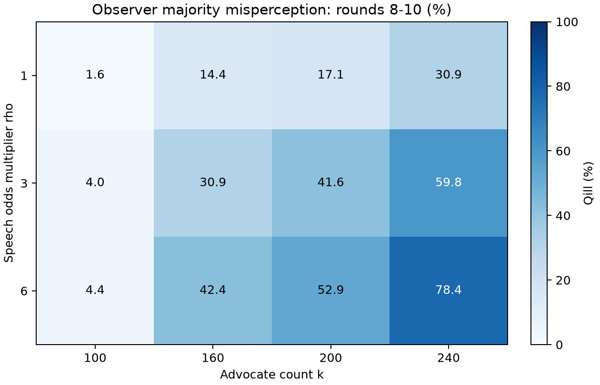
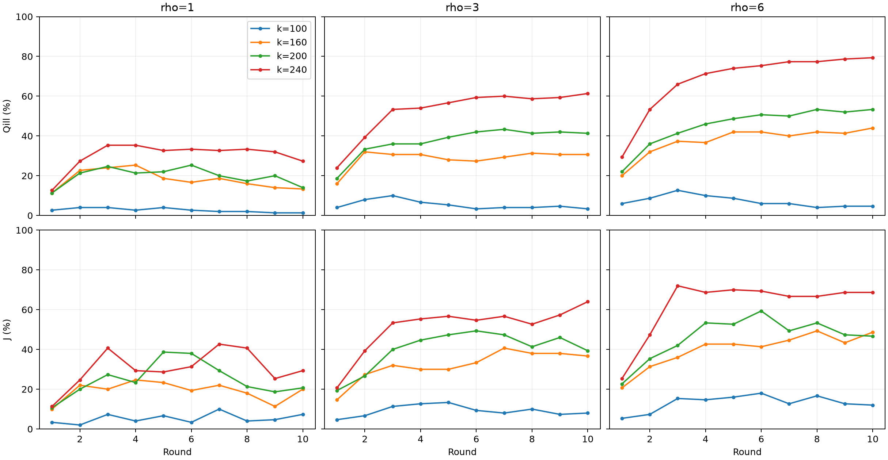
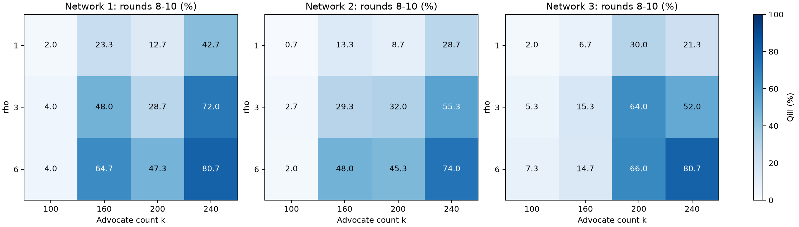
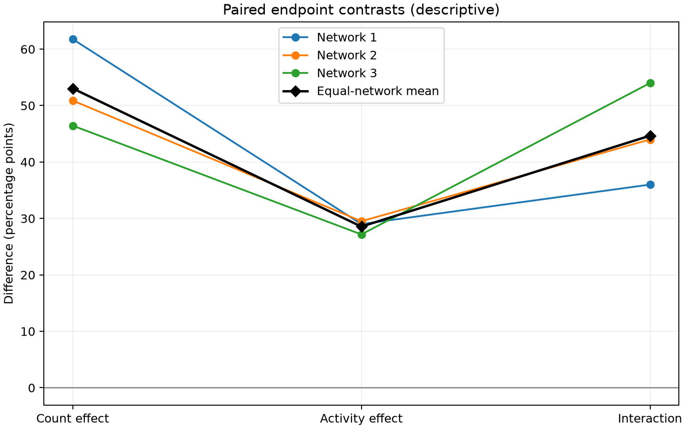
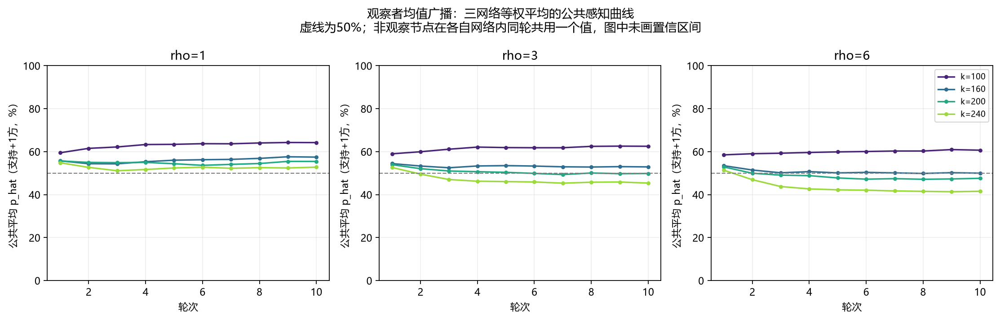

# 主实验二结果

完整轨迹：36。私人立场固定，仅50名观察者使用LLM。

本批采用观察节点均值广播：固定50名观察者本轮更新后的p_hat等权平均，含空阅读沿用值，供全部非观察节点下一轮决策使用。主指标仍取固定观察集合。

| 条件 | 图/组 | 末3轮Qill | 末3轮J | 初始IG |
| --- | --- | ---: | ---: | ---: |
| k=100, rho=1 | g0-r0 | 2.00% | 2.00% | 3.56% |
| k=100, rho=3 | g0-r0 | 4.00% | 4.67% | 3.56% |
| k=100, rho=6 | g0-r0 | 4.00% | 8.00% | 3.56% |
| k=160, rho=1 | g0-r0 | 23.33% | 21.33% | 7.14% |
| k=160, rho=3 | g0-r0 | 48.00% | 46.67% | 7.14% |
| k=160, rho=6 | g0-r0 | 64.67% | 58.67% | 7.14% |
| k=200, rho=1 | g0-r0 | 12.67% | 14.00% | 10.50% |
| k=200, rho=3 | g0-r0 | 28.67% | 35.33% | 10.50% |
| k=200, rho=6 | g0-r0 | 47.33% | 48.00% | 10.50% |
| k=240, rho=1 | g0-r0 | 42.67% | 39.33% | 16.05% |
| k=240, rho=3 | g0-r0 | 72.00% | 65.33% | 16.05% |
| k=240, rho=6 | g0-r0 | 80.67% | 68.67% | 16.05% |
| k=100, rho=3 | g1-r0 | 2.67% | 11.33% | 2.56% |
| k=100, rho=6 | g1-r0 | 2.00% | 17.33% | 2.56% |
| k=160, rho=1 | g1-r0 | 13.33% | 17.33% | 9.76% |
| k=160, rho=3 | g1-r0 | 29.33% | 41.33% | 9.76% |
| k=160, rho=6 | g1-r0 | 48.00% | 53.33% | 9.76% |
| k=200, rho=1 | g1-r0 | 8.67% | 18.67% | 10.50% |
| k=200, rho=3 | g1-r0 | 32.00% | 36.00% | 10.50% |
| k=200, rho=6 | g1-r0 | 45.33% | 42.00% | 10.50% |
| k=240, rho=1 | g1-r0 | 28.67% | 33.33% | 15.13% |
| k=240, rho=3 | g1-r0 | 55.33% | 58.00% | 15.13% |
| k=240, rho=6 | g1-r0 | 74.00% | 68.00% | 15.13% |
| k=100, rho=1 | g1-r0 | 0.67% | 6.00% | 2.56% |
| k=100, rho=6 | g2-r0 | 7.33% | 16.00% | 3.22% |
| k=160, rho=1 | g2-r0 | 6.67% | 10.67% | 5.71% |
| k=160, rho=3 | g2-r0 | 15.33% | 24.67% | 5.71% |
| k=160, rho=6 | g2-r0 | 14.67% | 29.33% | 5.71% |
| k=200, rho=1 | g2-r0 | 30.00% | 28.00% | 14.88% |
| k=200, rho=3 | g2-r0 | 64.00% | 55.33% | 14.88% |
| k=200, rho=6 | g2-r0 | 66.00% | 57.33% | 14.88% |
| k=240, rho=1 | g2-r0 | 21.33% | 22.67% | 16.97% |
| k=240, rho=3 | g2-r0 | 52.00% | 50.67% | 16.97% |
| k=240, rho=6 | g2-r0 | 80.67% | 67.33% | 16.97% |
| k=100, rho=1 | g2-r0 | 2.00% | 8.00% | 3.22% |
| k=100, rho=3 | g2-r0 | 5.33% | 9.33% | 3.22% |

## 预定主要比较（描述性）

| 比较 | 平均差值（百分点） | 网络1 | 网络2 | 网络3 |
| --- | ---: | ---: | ---: | ---: |
| count_endpoints | +53.04 | +61.78 | +50.89 | +46.44 |
| activity_endpoints | +28.56 | +29.00 | +29.50 | +27.17 |
| interaction_endpoints | +44.67 | +36.00 | +44.00 | +54.00 |

仅3张固定网络、各1组个体配置；展示配对差异和网络间一致性，不计算退化的图内bootstrap区间，不作显著性结论。
人数效应：k=240减k=100，跨rho平均；积极性效应：rho=6减rho=1，跨k平均；交互：两端人数差在rho=6与rho=1之间的差。









未达覆盖目标的条件记录为未达标；最小人数仅限本次已测网格，不外推为普适阈值。

## 调用用量

```json
{
  "actual_calls": 17921,
  "reused_rows": 787,
  "ok": 17316,
  "api_error": 506,
  "invalid_response": 99,
  "other_status": 0,
  "known_input_tokens": 84267287,
  "known_output_tokens": 1511785,
  "calls_without_complete_usage": 506
}
```

已排除缓存复用行；缺失usage没有按实际零消耗解释，已知token不等于供应商最终账单。
结果仅针对本次冻结配置、固定网络与继承的TH位置。本批观察节点使用LLM、非观察节点采用观察均值广播，统一11条阅读及Beta-Binomial多评论；历史结果保持原协议。

## 完整性与恢复记录

36条轨迹均为十轮，全部通过独立逐节点审计。首次完成19条后因额度耗尽暂停；额度恢复后补齐其余17条。两条中断轨迹的原7轮、8轮前缀，与恢复后的消息、阅读、节点状态和行为决策完全一致。详见 [恢复前缀核对](../recovery_history/prefix_verification.json)。

恢复前发现Qoder插件自动升级至0.2.77；已备份新版，恢复本批冻结的0.2.75插件与补丁（字节哈希完全一致），并将插件引用固定到0.2.75。所有实际API请求前后均核对插件哈希；请求reasoning_effort=none、temperature=0、max_tokens=4096、timeout=180。客户端温度经本地插件按官方CLI字段透传，上游不回显内部最终采样温度。

含缓存重放的18,202条返回响应全部通过非思考检查；返回模型标识均为qoder-cn/dfmodel；报告的推理token均为0，最大输出127 token。原额度耗尽阶段506条API错误保留在日志中，恢复阶段未新增API错误。实际请求用量见上表，已排除787条缓存复用；另外2次长历史预检单列在preflight目录，不算正式实验。

## 公共平均感知



每个网络内，非观察节点共用本轮固定50名观察者的p_hat算术平均，供下一轮决策使用。这里p_hat表示+1方支持率，倡议者为−1方。图上是三网络等权平均，不能把均值越过0.5直接解释成三张网络都越过0.5。各网络逐轮值见 [public_signal.json](public_signal.json)。

主指标为观察节点误判比例；非观察节点采用同一公共值，其多数判断可能集体翻转，不能把该翻转直接当作自发局部相变。与旧版本同时存在感知规则和调用渠道差异，不将两批合并统计，也不把跨版本差异全部归因于平均广播。
